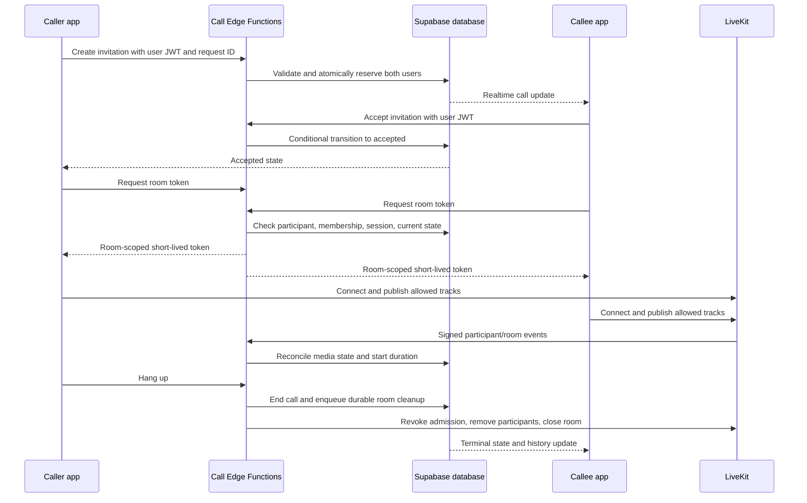

# DoloGram Voice and Video Calling Implementation Plan

Prepared: 2026-11-11 (Asia/Manila). Status: proposed implementation plan; no calling functionality is implemented by this document.

## 0. Planning status and execution rules

Polished against the working copy on 2026-11-11. This document authorizes no implementation, dependency installation, migration, deployment, build, service launch, or device operation. During this polishing pass only this plan and supporting artifacts under `docs/test-results/calling/plan-polish/` may change. Implementation starts only under a subsequent execution request.

**Evidence labels:** verified means inspected in the current local source or official documentation; reported means historical evidence, not a fresh pass; proposed means work or a design decision in this plan; unresolved means an identified prerequisite remains unconfirmed. All calling behavior and acceptance criteria remain unverified. The compact [context index](../docs/test-results/calling/plan-polish/context-index.md) identifies inspected files/ranges, source hashes, context freshness, exclusions, and this pass's checks. It is the entry point for continuing work.

**Rules shared by every execution phase:**

1. Recheck applicable instructions, working-copy status, relevant diffs, the context index, and the phase inputs before editing. Most application files are currently untracked; `git diff` alone is not a baseline. Preserve relevant tracked and untracked inputs with a recoverable, local, secret-free snapshot or patch before changes. Never reset or overwrite unrelated user work.
2. Use the context sequence: working-copy baseline, targeted discovery, reusable-context validation, scoped preparation, analysis, then original-source verification. Refresh only changed/dependent entries. Existing compressed Repomix packets are references, not instructions or substitutes for omitted source. No repository-wide packet is needed for this feature; if a future phase mandates/uses a packet, record selectors, included identities, exclusions, omissions, and complete read boundaries in the same index. Never include `.env`, service credentials, signing material, account/session stores, or private diagnostic payloads.
3. Deliver complete production-ready paths within the phase's scope: no user-visible stubs, placeholder credentials, empty handlers, or tests that only mirror implementation. Follow existing contracts, exports, route discovery, theme and error conventions. Add only dependencies needed for LiveKit/native support and the minimum test tooling needed to verify it. Remove only feature-obsolete code/assets after checking their callers; do not bundle unrelated refactors.
4. Establish and retain relevant pre-change checks, then rerun affected checks after relevant edits. Do not weaken assertions, skip required tests, or call historical results current. Separate pre-existing failures from regressions and record each check as passed, failed, blocked, or not run, with source/environment identity and evidence. Unverified required acceptance gates stay incomplete. This supersedes the earlier calling plan's use of the Android plan's optional-manual-verification convention; it does not edit the older Android plan.
5. Use bounded requests, jobs, listeners, and processes. After two failures for the same reason, preserve diagnostics, diagnose, and change approach or report the blocker before retrying. Stop task-created processes when done; never stop pre-existing user services. No unbounded effect-driven fetches, retry loops, or duplicate media/Realtime sessions.
6. Android verification is **emulator-only**, on the assigned MuMu instance with `com.dologram.app`; no physical device, unrelated emulator, or other installed app may be used. Historical identifiers disagree: the original constraint names `emulator-5554`; the latest report identifies the same assigned `dologram` MuMu instance at `127.0.0.1:16480`. Before any later device operation, confirm the assigned instance/package identity from allowed inventory/configuration; do not select another instance because an old serial is absent. Current live identity is unresolved; no device was accessed in this pass.
7. Reuse a compatible approved development client/artifact. No speculative rebuilds or assumed quota: record installed modules/build fingerprint, build need, remaining allowance, upload permission, and chosen EAS profile first. Cloud EAS is the existing build method; local native builds remain excluded. The older report records an EAS source-upload authorization blocker; this planning request does not resolve it. Native dependency changes require a compatible new artifact, so an old development APK is not proof of calling support.
8. Before integration tests, identify and confirm a dedicated Supabase test target, LiveKit test project, disposable accounts/chats, provider webhook/scheduler settings, and permitted peer endpoint. Never run fixtures against shared/production accounts because an older test does so, and never infer isolation from a container. Credentials stay in approved secret stores and out of command output. Use bounded test fixtures and disable external notification dispatch except to designated test recipients.
9. Use phase work items and reporting in Section 9. Unavailable external prerequisites can leave independent work runnable, but cannot turn an unmet gate into a pass. Ask only for a missing artifact/authorization/decision that blocks dependent work, explaining its exact source and effect; do not seek fresh approval for already authorized actions.

## 1. Goal and scope

Implement one-to-one internet voice and video calls inside DoloGram using:

- **LiveKit Cloud:** transport microphone and camera streams.
- **Supabase Postgres and Realtime:** persist invitations, authoritative call state, participants, and history; notify signed-in clients about changes.
- **Supabase Edge Functions:** authenticate callers, enforce membership and call permissions, issue short-lived LiveKit tokens, process signed LiveKit events, and clean up abandoned sessions.
- **Expo/React Native screens:** outgoing call, incoming call, connecting, active call, reconnecting, and ended states, with answer, decline, hang up, mute, audio routing, camera toggle, and camera switch controls.

Delivery target: the existing Android app first. Keep shared contracts and the media abstraction suitable for iOS and a future web client, but do not claim support for those clients before their own builds and verification.

The first usable milestone supports calls while both apps are in the foreground. A subsequent milestone adds notification invitations. Reliable lock-screen calling and continued calls in the background require a separate native integration milestone described in Section 10.

Initial exclusions: group calls, telephone numbers/PSTN, recording, transcription, screen sharing, picture-in-picture, call transfer, and voice-to-video upgrades during an existing voice call. A voice call publishes microphone audio only; a video call permits microphone and camera tracks, with explicit camera controls. Transport encryption is used, but application-managed end-to-end encryption is a separate future design and must not be advertised as implemented.

### 1.1 Requirements, implementation coverage, and observable acceptance

Stable IDs below cover the agreed calling scope. V0-V8 refer to Section 11 verification groups. All are **not run** for calling. C6/C7 acceptance belongs to those later milestones and must not block a correctly labelled foreground release or be represented as delivered by it.

| ID | Observable acceptance criterion | Implementation coverage | Verification |
| --- | --- | --- | --- |
| CALL-01 | A starts a voice call in an eligible A-B chat; B answers; both exchange audible media; either ends it and both leave. No camera track is allowed. | C1-C3; Sections 4-7 | V1, V2, V4, V5: real peer/media exchange plus source-grant rejection. |
| CALL-02 | A starts video; B can answer with camera off; both can exchange video/audio when enabled. Turning camera off releases its capture without ending voice. | C2, C4; Sections 6-7 | V2, V4, V5: track observations, rendering and capture teardown. |
| CALL-03 | Accept, decline, caller cancel, no-answer expiry, connection failure and hang-up produce exactly the allowed transitions in Section 5.2; terminal calls never reopen. | C1-C3, C5 | V1, V2, V4: action/deadline/race cases and late-event replay. |
| CALL-04 | Concurrent invitations reserve each user once; duplicate create IDs do not duplicate attempts; only the bound caller/first accepting callee session receives tokens. | C1-C3 | V1, V2, V4: parallel transactions, response loss, opposite-direction calls, two accepting sessions. |
| CALL-05 | Anonymous/unrelated/nonmember users cannot read/control/join calls, and restricted users cannot initiate/join; groups/self/incomplete chats cannot initiate. Access loss triggers cleanup. A bound participant with a valid JWT can still end after restriction; an invalidated session stops locally and is cleaned up by the server. | C1-C2, C5 | V1, V2: direct table/RPC/function attacks; revoke access during a live call. |
| CALL-06 | Only the Edge backend mints five-minute room/source-scoped credentials after acceptance; client/Realtime/history/logs expose no signing secret; ended-call credentials fail admission, including refreshed/late credentials. | C0-C2, C8; Section 6 | V1, V2, V8: claims inspection, invalid signatures, issuance/end race, cutoff boundary, fresh artifact scan. |
| CALL-07 | Mute, actual available speaker/earpiece route selection, hang-up, camera on/off and available-camera switch reflect SDK outcomes. Unsupported routes/cameras are disabled/explained rather than simulated as successful. | C3-C4 | V4, V5: SDK state/track checks and allowed MuMu media/route observations. Hardware-only assertions stay unverified if unavailable. |
| CALL-08 | Denying microphone prevents create/accept; denying camera permits camera-off video participation. Permission prompts do not end a call on blur. Controls have labelled roles/states, theme contrast, reduced-motion behavior, and at least 48 dp targets without overlap at large text. | C3-C4 | V4, V5: permission cases, accessibility tree/layout, settings return and prompt lifecycle. |
| CALL-09 | An incoming call appears while a different chat is open; stale/duplicate events do not ring twice. Back inside the app preserves one media session and exposes a return banner. | C3, C5 | V4, V5: global subscription, subscribe/fetch race, reconnect and navigation. |
| CALL-10 | Every hang-up, error, sign-out, active-account removal/switch, confirmed background and process-loss path releases local resources; old-account async results never connect; voice recording/playback cannot compete for call audio. | C3-C5 | V2, V4, V5: all discovered auth callers; recorder preparation race; track/listener/timer counts and server crash recovery. |
| CALL-11 | Lost webhooks, signaling/media outages, process death and provider errors converge to authoritative state within the stated healthy-service budgets; bounded retries neither duplicate effects nor leak reservations/rooms. | C1-C2, C5 | V1, V2, V4, V5: fault injection, scheduler overlap, worker restart, due scans and reconciliation. |
| CALL-12 | The accessible chat's Calls screen is reachable; pages show correct direction/type/outcome/time/duration once per attempt. Call again uses a new request and eligibility checks. Unavailable history shows an honest offline/error state. | C1, C5 | V1, V3-V5: tied timestamps/page boundaries, unauthorized access, zero-duration outcomes, retry and deletion. |
| CALL-13 | A valid C6 invitation notification opens the correct active account's still-live call; expired/cancelled/wrong-account pushes cannot answer/join. Message notifications still work. | C6; Sections 7, 10 | V2, V4, V6: dispatch/tap/foreground handler/channel cases and expired pushes. |
| CALL-14 | C7's Android background/lock-screen behavior follows its recorded platform-state support matrix; force-stop limitations are stated; native end/answer routes through the same server state machine. | C7 | V2, V4, V7: native actions, service lifecycle, lock/unlock and cancellation on the assigned MuMu. |
| CALL-15 | SDK 57/RN 0.86 builds use a compatible pinned LiveKit set; missing-native/disabled clients still start, message and switch accounts. New calls require a verified compatible artifact. | C0, C3, C8 | V0, V4, V5, V8: dependency/config/import checks, old-runtime fallback and authorized native build. |
| CALL-16 | Global/chat notification and mute settings control alerts; a device-locally blocked chat cannot launch or ring in the foreground. C6 dispatch honors its last synchronized device preferences and server mute state; taps always revalidate. History is retained. No server-wide blocking or retroactive prevention of an already displayed OS notification is claimed. | C3, C5-C6 | V2, V4-V6: silenced vs visual invitation, local block, preference synchronization/channel changes and privacy defaults. |
| CALL-17 | Server flags, rate limits, max duration and quota failures work across devices; healthy-service timing budgets are measured; diagnostic output contains only permitted metadata. | C1-C2, C5, C8 | V1, V2, V5, V8: limits/disabled state, timings, job lag, provider quota error, scrubbed logs. |
| CALL-18 | A source-matched release artifact passes the relevant checks, supports only verified modes, and can be disabled while cleanup/history continue; baseline failures and unmet gates remain visible. | C0-C8 as delivered | V0, V8 plus required V1-V7 results for the delivered milestones; rollback rehearsal. |

## 2. Repository findings and integration constraints

| Existing location | Reuse or planned change |
| --- | --- |
| `apps/mobile/package.json` | Expo `~57.0.32`, React Native `0.86.3`, existing `expo-dev-client`, `expo-audio`, `expo-video`, and `expo-notifications`. Verify LiveKit native compatibility before committing to SDK versions. |
| `apps/mobile/app/_layout.tsx` | Mount an authenticated, account-scoped call provider and global incoming-call presentation. Extend the existing notification response router. |
| `apps/mobile/app/chat/[chatId]/index.tsx` | Add voice and video buttons to the chat header for eligible direct chats. Retain the existing info action. |
| `apps/mobile/src/chat/realtime.ts` | Existing per-chat Broadcast is used for typing/read hints and is mounted with a chat. Incoming calls need an app-wide subscription, not just this chat channel. |
| `apps/mobile/src/sync/source.ts` | Existing Postgres Changes delivery and payload validation offer patterns to reuse. Calls get a separate delivery lifecycle rather than being forced into message synchronization. |
| `apps/mobile/src/notifications/pushNotifications.ts` | Reuse registration and response subscriptions; distinguish call invitations from message notifications. |
| `apps/mobile/src/auth/accountSession.ts` (`activateAccountSession`, `switchToSavedAccount`), `apps/mobile/src/storage/localData.ts` (`clearLocalData`) | Add pre-session-change teardown while the old JWT is valid, plus account-generation cleanup in the provider. |
| `apps/mobile/app/(main)/(tabs)/settings.tsx`, `app/manage-accounts.tsx`, `src/components/AccountSwitcherPopover.tsx` (under `apps/mobile/`) | These also call `auth.signOut`, some without `clearLocalData`; every active-account sign-out/removal path needs the same narrow teardown hook. Sign-in/up activation already passes through `activateAccountSession`. |
| `apps/mobile/src/components/VoiceRecordButton.tsx`, `VoiceNotePlayer.tsx`, `VideoPlayback.tsx` | Coordinate audio ownership so voice recording/playback and calling do not capture or configure the microphone simultaneously. |
| `apps/mobile/app.json`, `app.config.js`, `eas.json` | Add native configuration through Expo config plugins and produce a new EAS development build, followed by a preview build. |
| `packages/shared/src/db/database.types.ts`, `strings/index.ts`, `theme/icons.ts` | Regenerate database types and add common call contracts, copy, and icons. Keep the native LiveKit dependency outside the shared package. |
| `apps/mobile/src/components/Icon.tsx` (`lucideRegistry`) | The renderer explicitly imports/registers glyphs and returns null for unregistered names. Add necessary call glyphs to both this registry and the semantic shared map; preserve current asset-backed star behavior and unrelated concurrent icon edits. |
| `supabase/migrations/016_align_messenger_schema.sql` | Use the current `chats.chat_id`, `chats.type`, and `chat_members.user_id` contract, not the original pre-alignment schema. |
| `supabase/functions/send-push-notifications/` | Reuse delivery patterns and active-user checks; retain separate call payloads, expiry rules, preferences, and deduplication. |
| `apps/mobile/src/chat/query.ts` (`ChatScreenSnapshot`), `src/chats/preferences.ts` (under `apps/mobile/`) | Snapshot already exposes `chat`, `members`, and `savedMessages`; use these for affordances. `blocked`, `notifications`, and `sounds` are device-local preferences; `chat_members.muted_until` is server-backed. Do not invent a server block list. |
| `apps/mobile/src/notifications/pushNotifications.ts` (`loadNotifications`, `handleNotification`, `androidChannelId`) | Optional-native loading already avoids incompatible clients. The notification handler/channel currently assumes messages; extending only the tap router would suppress generic call alerts. |
| `scripts/scan-mobile-bundle.ps1` | Current patterns cover Supabase/admin secrets, not LiveKit secrets. Extend coverage in C2 and scan a fresh matching export in C8. |

Verified correction: the working copy now has `025_add_group_chat_avatars.sql` and **`026_shared_chat_nicknames.sql`**, so the earlier duplicate-025 finding is stale and is not a repair task. Deployed history is uninspected. Allocate the next zero-padded sequence from the verified execution target and current repository immediately before implementation, preserving applied versions per `supabase/AGENTS.md`; `<next>` below is deliberate.

No calling modules, LiveKit dependencies, call schema, calling endpoints, call rate-limit infrastructure, or call scheduler are present in the inspected source. Existing SQL tests are transactional assertion scripts, not a confirmed pgTAP runner. Local presence of notification code does not prove hosted deployment, Firebase configuration, or runtime support. The older Phase 17 report records passing typecheck/shared tests/export, pre-existing sign-up lint findings, and a stopped full-Jest hang; none were rerun or promoted to current calling evidence during polishing.

Use the actual `apps/mobile/app/` routes. The mobile AGENTS file's generic `src/app/` guidance does not match the existing layout; do not move existing routes for this feature.

Follow existing EAS cloud-build conventions. Do not create or edit generated Android/iOS projects manually. Install native dependencies with `npx expo install`, pin the versions validated with SDK 57, and record them in `docs/versions.md`. LiveKit needs a development build and cannot run in Expo Go. [LiveKit Expo guide](https://docs.livekit.io/transport/sdk-platforms/expo/), [Expo SDK 57](https://docs.expo.dev/versions/v57.0.0/)

## 3. Product behavior and initial defaults

These are implementation defaults, adjustable through server configuration after observing usage:

| Decision | Initial behavior |
| --- | --- |
| Eligible conversation | A direct chat with exactly two distinct current members. Reject groups, Saved Messages, and incomplete one-member direct chats. |
| Concurrent calls | One ringing, accepted, or active call per user across devices and chats. The database enforces this. |
| Ring window | 30 seconds from server creation time. Network delivery does not extend the deadline. |
| Connection window | 30 seconds after acceptance to establish both participants, otherwise fail and release reservations. |
| Disconnect grace | 20 seconds for a connected participant to recover; reconciling server state determines the final result. |
| Token TTL | 5 minutes for initial admission. Check exact SDK refresh and revocation behavior in the compatibility milestone. |
| Pilot maximum duration | 30 minutes, enforced by the server, with a visible warning near the limit. This is a configurable budget control, not a LiveKit free-plan limit. |
| Camera privacy | No remote camera/microphone publishing before acceptance. Camera preview is local and optional. Support answering a video invitation with camera initially off. |
| Speaker default | Voice: earpiece when available. Video: speaker when no headset is connected. Prefer the connected wired/Bluetooth route and reflect the actual route in the UI. |
| Background, first milestone | Foreground-only. A confirmed Android `background` transition stops publishing and ends the call on a best-effort basis; server cleanup covers process termination. A permission dialog/focus blur alone must not cancel an answer or call. Do not promise background audio until the native milestone ships. |
| Navigation within app | Back minimizes an active call into a persistent return-to-call banner; only hang up ends it. Maintain one media session above individual screens. |
| History | Per-chat Calls screen with incoming/outgoing, voice/video, outcome, timestamp, duration, and call-again actions. No new main tab or message schema change is required. |
| Notifications | Respect account notification settings and chat mute preferences for audible alerts. A persisted invitation/history record remains even when alerts are silenced. |

If a user is offline, never add a call action to the existing message queue. Show an immediate connectivity error. Reconnection may reconcile an existing call; it must not replay an expired invitation.

Server deadline comparisons use database UTC time, not client clocks. Include `serverTime` in state responses to estimate display offset, and use monotonic elapsed time between refreshes. A 30-second ring deadline is a strict acceptance cutoff even if a worker has not yet changed the displayed database status.

The foreground caller is bound to its client session during **create**, not on the first token request; otherwise another signed-in device could seize the outgoing call. The callee is bound on the first valid accept. A client-session UUID identifies a runtime instance for honest multi-device coordination; it is not an independent authentication credential or proof of physical device identity. Generate it once per authenticated runtime and never copy it from another client's event. A fresh runtime cannot take over an active call; reconcile/end the stale session and create a new attempt if needed.

## 4. Architecture and end-to-end flow



Supabase is authoritative for permission, invitation status, and history. LiveKit is authoritative for media connectivity. Client events improve responsiveness but cannot establish another user's acceptance, rewrite history, or certify that a peer actually joined.

Create no room connections and issue no media tokens during ringing. This limits accidental publishing and avoids spending participant minutes on unanswered invitations. A unique opaque room name is generated per call and never reused.

After acceptance, provision that room idempotently with a two-participant limit before returning admission tokens. Persist its SID/readiness privately. Concurrent token requests share the same provisioning result; a missing room during provisioning is not a completed-call signal. Provider creation failure is retryable only within the connection window and ends as `failed` if that deadline expires.

## 5. Database and authoritative state

### 5.1 Proposed tables

| Table | Core fields and responsibility |
| --- | --- |
| `calls` | `call_id`, `chat_id`, `caller_id`, `callee_id`, `media_type` (`voice`/`video`), `status`, `created_at`, `ring_expires_at`, `accepted_at`, `connect_expires_at`, `connected_at`, `ended_at`, `ended_by`, `end_reason`, monotonic `revision`, caller-scoped `request_id`. One row per attempt, including a busy outcome. |
| `call_participants` | Safe public connection observations only: composite key `(call_id, user_id)`, role, current connected flag/generation, join/leave timestamps, and participant `revision`. Exactly the two intended users. Keep device-session bindings and provider identifiers in `private.call_rooms` or its private participant mapping. |
| `private.call_user_reservations` | `user_id` primary key, `call_id`, next reconciliation deadline. Atomically reserve both users during ringing and retain through accepted/active states. No client reads/writes or Realtime publication. |
| `private.call_rooms` | Internal mapping from call to unique room name, room SID/generation, participant identities/session bindings, readiness, issuance epoch/lease, latest finalized token `nbf`/expiry metadata, revocation/cleanup state. No raw tokens. Not published through Realtime or readable by normal users. |
| `private.call_jobs` | Durable outbox for room cleanup and, later, invitation push dispatch. Include unique deduplication key, attempt count, next attempt, and completion/error state. |
| `private.call_webhook_events` | Provider event ID primary key, processing status, event timestamp, and minimal required metadata. Deduplicate replayed events; avoid persisting tokens or unnecessary raw payloads. |
| `private.call_settings`, `private.call_rate_limits` | Singleton feature/default settings and durable per-user/per-pair attempt windows. These do not exist yet; add them rather than referring to an assumed general rate-limit service. |

Use foreign keys to `public.chats(chat_id)` and `auth.users(id)`, status/media checks, caller-not-equal-to-callee checks, and consistency constraints on terminal timestamps. Index `call_participants(user_id, call_id)`, `calls(chat_id, created_at desc, call_id desc)`, and pending deadlines/jobs. History filters the current pair and uses the latter call index; do not index a participant `created_at` column that is not defined. Make `(caller_id, request_id)` unique to handle create retries without duplicate calls or notifications; reusing a request ID with different chat/media inputs is a 409, not a new attempt.

History follows existing chat/account deletion: use the chosen call foreign-key delete behavior consistently, with no automatic time-based history purge in this release. Before a related call row can be deleted, persist sufficient opaque room/participant cleanup data in a private job that survives the cascade. A job must not depend on deleted user/chat rows to terminate media. Keep provider credentials outside it. Test this deletion path, including deletion during a live call.

Keep operational tables in a private schema. Return only safe call fields through authenticated endpoints/RLS. Tokens are never database history fields, URLs, push payloads, analytics attributes, or SQLite values.

### 5.2 State transitions

| From | To | Authorized trigger |
| --- | --- | --- |
| none | `ringing` | Caller creates a valid invitation and both reservations succeed. |
| none | `failed` (`busy`) | Valid attempt finds either participant reserved; return busy and persist a single history outcome without disturbing the existing call. |
| `ringing` | `accepted` | Callee accepts before the server deadline; bind the winning callee client session. |
| `ringing` | `declined` | Callee declines. |
| `ringing` | `cancelled` | Caller cancels. |
| `ringing` | `missed` | Server ring deadline passes without an earlier transition. |
| `accepted` | `in_progress` | Server verifies both expected participants are connected to the current LiveKit room. |
| `accepted` | `ended` | Either participant hangs up before connection completes. Duration is zero. |
| `accepted` | `failed` | Connection deadline passes or unrecoverable permission/provider setup fails. |
| `in_progress` | `ended` | Either participant hangs up, maximum duration is reached, or a server policy terminates the call. |
| `in_progress` | `failed` | Media does not recover within the disconnect grace period, or a provider failure is confirmed. |

`declined`, `cancelled`, `missed`, `ended`, and `failed` are terminal. Never reopen a terminal call. `connecting` and `reconnecting` are UI/participant states, not alternate invitation statuses.

Every transition runs in a transaction with row locking, deadline checks, and a conditional current-state/revision check. Reserve users in a stable user-ID order to avoid deadlocks. A unique reservation row enforces the rule even when different chats call the same user at the same moment. Simultaneous A-to-B and B-to-A calls produce one ringing call and a busy response for the losing attempt; its client can discover the existing incoming call.

Repeated accept/decline/hang-up requests return the resulting authoritative state. If accept races cancel or timeout, the first valid database transition wins. Only one device can win acceptance; the remaining devices dismiss their ringing UI. A reconnect by that selected session is allowed; another device cannot silently take over.

Release reservations in the same transaction as terminal state and durable cleanup enqueueing. Expired rows are not deleted blindly: the worker first reconciles and terminalizes the owning call. Client clocks and missing heartbeats alone are not evidence that an otherwise healthy media call ended.

All accepted/live calls have a due reconciliation time even if no webhook arrives. Check actual room presence at least every ten seconds during the pilot, advancing the deadline after a successful observation. A lost leave event is detected by this scan. Set a disconnect deadline on the first confirmed absence; terminalize only after the 20-second grace plus the next scan, unless an explicit terminal action already won. If the provider is unavailable, do not infer disconnection from an API timeout; retain a reconciling state and alert, and enforce the duration cap when service recovers. Expose this bounded/eventual termination limitation in operational evidence. Healthy observed media must not lose its reservation because an arbitrary lease expired.

Duration is server-defined elapsed time from the first verified simultaneous connection to terminal time, including short reconnect gaps. Store timestamps and derive duration, rather than trusting the client timer. If only one side joined, duration remains zero. For failures detected later, use the last confirmed media/disconnect time where available; mark uncertain measurements internally rather than inventing precision.

### 5.3 RLS and database functions

- Permit history/state reads only to the recorded caller or callee while they still have access to that chat. Membership alone must not reveal a previous pair's call to a newly added member.
- Deny direct authenticated inserts/updates/deletes to call state, participant bindings, reservations, and operational tables.
- Expose proposed service-only transaction RPCs `call_create`, `call_transition`, `call_prepare_admission`, `call_finalize_admission`, and `call_reconcile`. No authenticated/anonymous client gets EXECUTE. Edge Functions verify the user JWT first and pass the resulting actor ID through an admin/service-role client; the database sees that service role, so it must not assume `auth.uid()` still represents the user. Each RPC explicitly checks the supplied verified actor against stored caller/callee, membership, account state, session binding, and permitted transition. Scheduler-only actions are separate from user actions. Deny PUBLIC/anon/authenticated execution and test attempted direct invocation. Ordinary clients only read safe RLS-protected rows.
- If any function uses `SECURITY DEFINER`, pin `search_path`, fully qualify references, revoke default/public execution, grant only its intended role, and explicitly check actor and membership. Private worker-only functions accept verified server authority only.
- Call lifecycle functions must validate active-account restrictions already used by notification delivery, including bans and mandatory password changes. Apply these checks again when issuing tokens.
- Recheck both users against the authoritative Auth ban/password-change state on create/accept/admission and during active reconciliation. The existing notification function's `isActiveUser` checks `auth.users` through the Auth admin API; the public profile flag alone is insufficient. A restricted/deleted account cannot create new media, but an already-bound participant must still be able to end/disconnect its existing call. Membership/account deletion must enqueue cleanup using the deletion-safe job design above; access loss detected by periodic reconciliation also terminates media. No new general admin/account-management feature is required.
- Add only the safe call/participant tables to `supabase_realtime`; do not publish secrets, webhook payloads, or the operational tables.

For database-side account checks, implement a private, tightly granted helper that reads the required `auth.users` ban/app-metadata state; confirm actual target columns in C1. Do not trust actor/status booleans submitted by an ordinary client or assume a public profile flag matches Auth. The service-only RPC rechecks transactional permissions; the Edge's verified user/session and admin check are additional boundaries. Keep endpoint/internal worker grants separate and prove ordinary JWTs cannot call worker-only actions.

## 6. Edge Function contracts and security

### 6.1 Endpoints

| Endpoint | Request | Result and checks |
| --- | --- | --- |
| `call-action` | `{ action: 'create', chatId, mediaType, requestId, clientSessionId }` | Validate JWT, active users, exactly two eligible members, rate limit, feature flag, and reservations. Derive callee and actor server-side. Return safe call state. |
| `call-action` | `{ action: 'accept' | 'decline' | 'cancel' | 'end', callId, requestId, clientSessionId }` | Check actor role, membership, selected-session policy, status, and deadlines; invoke the corresponding atomic transition. |
| `call-action` | `{ action: 'snapshot', callId? }` | Return the caller's safe active/incoming state (or the accessible specified call), feature availability, and `serverTime`; never return private session bindings or operational rows. This supports startup/reconnect and deadline displays. |
| `call-token` | `{ callId, clientSessionId }` | Admit only the bound caller or selected accepting callee to an accepted/in-progress call. Return `{ serverUrl, participantToken, expiresAt, callId, revision, serverTime }` after final authorization. |
| `livekit-webhook` | Provider-signed raw body | Verify LiveKit signature/body integrity, persist/deduplicate event, map room and identity to the intended call, reconcile, and enqueue cleanup where required. |
| `reconcile-calls` | Server scheduler credential | Expire ringing/connecting calls, confirm media recovery or failure, process retry jobs, enforce duration limits, and repair missed provider events. Not callable by ordinary users. |
| `send-call-notifications` | Internal outbox job, later milestone | Resolve current eligible tokens/preferences and send short-lived, deduplicated invitation notifications. No user-supplied recipient list. |

Use `supabase.functions.invoke` with the active user's JWT for user endpoints, verify authentication server-side, and retain platform JWT verification where supported. Existing webhook functions with `verify_jwt = false` are not templates for unauthenticated user endpoints. Provider webhooks need `verify_jwt = false` because LiveKit does not supply a Supabase JWT; signature verification is mandatory inside the handler. [Supabase function authentication](https://supabase.com/docs/guides/functions/auth)

Use a stable error envelope such as `{ code, message, retryable }`. Cover `CALL_BUSY`, `CALL_EXPIRED`, `CALL_ALREADY_HANDLED`, `CALL_NOT_ALLOWED`, `CALL_PERMISSION_REQUIRED`, `CALL_PROVIDER_UNAVAILABLE`, `CALL_FEATURE_DISABLED`, and `CALL_RATE_LIMITED`; map them to shared user-facing strings. Return 401 for invalid authentication, 404 for inaccessible calls to avoid disclosing existence, 409 for conflicting state, and 429 with retry guidance for limits. Recover a lost response by reading the authoritative state, not by creating a new attempt ID.

Accept POST only (plus inert OPTIONS where needed); reject malformed JSON, oversized bodies (initial cap 8 KiB), invalid UUIDs/enums, and unexpected actor/room/recipient fields before database writes. Error/log output must not serialize JWTs, provider headers, or SDK request objects. A permission-required condition is ordinarily local UI state, not proof sent by a client to bypass admission checks.

Proposed request bounds: client action/token timeout ten seconds; one automatic retry after a transient timeout/5xx using the same request ID, then reconcile/show retry. Do not retry authorization/validation/conflict failures as transport errors. For a 429, honor `Retry-After` only while the invitation/connection deadline remains valid. Provider HTTP calls are bounded to five seconds; interactive calls do not spin on provider faults. Realtime recovery polls at most every five seconds for a live call, with at most one in-flight request; stop on terminal/account/background transitions. Jobs take a single fenced claim, use backoff (initially 2, 5, 15, then 60 seconds), and escalate after five unsuccessful attempts while retaining the durable cleanup record for controlled recovery. Apply the two-identical-failures diagnosis rule in Section 0 to execution commands, not by disabling essential operational recovery.

### 6.2 Token policy

- Store `LIVEKIT_URL`, `LIVEKIT_API_KEY`, and `LIVEKIT_API_SECRET` only in Edge Function secrets. Keep privileged Supabase credentials server-side. No `EXPO_PUBLIC_` LiveKit secret or client-side token minting.
- Use a server-generated opaque identity per call participant and a unique opaque room name. Do not put names, usernames, emails, or telephone numbers in these identifiers.
- Allow joining exactly the call's room, subscribing, and publishing only the required sources. Voice permits microphone; video permits microphone and camera. Deny room administration, recording, room listing, screen sharing, and unrelated data publishing.
- Set explicit five-minute initial TTL. Keep returned tokens in memory only and discard them on call end or account change.
- Check current state, participant/session binding, membership, and server feature flags on every issuance. A caller may never supply an arbitrary room or participant identity.
- TTL does not end an already connected call. Ending a call requires server removal/revocation and room cleanup, plus the database terminal state. LiveKit refreshes connected participants' credentials; validate removal against refreshed tokens too. [LiveKit token lifecycle and grants](https://docs.livekit.io/frontends/reference/tokens-grants/)

### 6.3 Cross-service failure handling

Database transactions and LiveKit API requests cannot be one atomic transaction. Use durable jobs, bounded retries, and idempotent provider operations rather than assuming both succeed together.

Implement admission fencing explicitly: `call_prepare_admission` locks the call, checks current state/actor/session/deadlines, and grants a short issuance lease tied to the call's epoch. Sign a token in the function, then `call_finalize_admission` reacquires the row lock, verifies the same epoch/lease and current permissions, and records only its `nbf`/expiry metadata before allowing the HTTP response. A terminal transition increments the epoch, invalidating any unfinished issuance. Never return a token after failed finalization. A response finalized just before termination can arrive late, so termination still has to revoke all finalized credentials.

The cleanup job uses `RoomServiceClient.removeParticipant(room, identity, { revokeTokenTs })` for both identities and then deletes the room. The documented JS option is a `bigint`; the Room Service API cutoff is **Unix seconds**, must be near the provider's current time (within 60 seconds), and rejects token `nbf` values earlier than the cutoff. Select a current cutoff strictly later than the latest finalized token `nbf`, including same-second issuance, and cover provider-refreshed credentials/observed clock skew. Do not replay an old termination timestamp as a cutoff minutes later: retries use a valid current cutoff. Verify this with the pinned SDK in C2. The provider's documented revocation window is finite, and refreshed-token expiry must be tested across that boundary. [Removal options](https://docs.livekit.io/reference/server-sdk-js/types/RemoveParticipantOptions.html), [Room Service removal contract](https://docs.livekit.io/reference/other/roomservice-api/)

Do not assume deleting a room alone makes an issued join token unusable, default TTL covers refreshed tokens, or the default revocation buffer rejects the newest token. C0 confirms the documented API/version contracts; **C2** must demonstrate old and refreshed credentials cannot revive an ended call, including in-flight issuance, same-second admission, late responses, and provider retry. A failed proof blocks this security gate and requires diagnosis/provider-supported correction; no custom ad hoc JWT signing or silent weakening of the requirement. Provider outages mean remote termination is eventually confirmed, not instantaneous; local teardown and database denial happen immediately and cleanup failures remain visible.

On create/accept provider failure, retain recoverable database state only within its connection deadline. On a lost token response, a safe retry is allowed for the same bound session while the call is live. On an end failure, both clients stop local media immediately, the database remains terminal, and the cleanup job retries until provider termination is confirmed. Unconfirmed cleanup is an operational alert, not a successful server cleanup result.

After committing an explicit terminal action and its outbox job, the handler attempts that same idempotent cleanup immediately within a five-second overall provider budget, removing the two identities concurrently before room deletion. It returns the terminal database state even if provider cleanup is still pending; it must not wait for the next ten-second sweep or claim provider completion without confirmation. The durable job covers interruption/timeouts and prevents a function-exit background promise from being the only cleanup mechanism.

Verify webhook signatures against the unmodified request body with the pinned server SDK; do not parse and reserialize first. Use event IDs for idempotency, room SID and participant connection generation to reject stale leave events, and current LiveKit state when event ordering is ambiguous. Never revive a terminal call after a late join event; remove the participant instead. LiveKit webhook delivery is not guaranteed, so a scheduled worker must reconcile with the Room Service API. [LiveKit webhook delivery](https://docs.livekit.io/intro/basics/rooms-participants-tracks/webhooks-events/), [Room Service API](https://docs.livekit.io/reference/server-sdk-js/classes/RoomServiceClient.html)

Use Supabase Cron/`pg_cron` for SQL deadline processing and durable job claims. Enable `pg_net` and approved secret storage only if needed for scheduled Edge invocation; no scheduler/extension is assumed deployed. Supabase documents second-based schedules. Run a lightweight SQL sweep every ten seconds, invoking the reconciler only for due active calls/jobs, not an empty Edge request every tick. Overlapping workers claim bounded batches with `FOR UPDATE SKIP LOCKED` and expiring job leases; no network call runs while holding a database transaction open. A room-not-yet-created state during acceptance must be distinct from an unexpected missing active room. Record actual scheduling latency and invocation budget in C1/C2. UI dismisses expired ringing at the server deadline; conditional SQL still rejects late acceptance before a sweep. [Cron](https://supabase.com/docs/guides/cron), [Cron quickstart](https://supabase.com/docs/guides/cron/quickstart)

Proposed observable pilot bounds under a healthy provider/test network: server-authorized hang-up makes the other UI terminal within five seconds; provider cleanup confirms within ten seconds; abandoned ringing reservations clear by the 30-second deadline plus one sweep and five seconds of processing (45 seconds from create). Media failure terminalizes after the first server-confirmed absence plus 20-second grace, one sweep, and five seconds of processing. These are test acceptance budgets, not an SLA or claims of measured performance. Measure and report misses; do not increase budgets merely to make a test pass.

## 7. Mobile call lifecycle and screens

### 7.1 Modules

Create `apps/mobile/src/calls/` containing:

- `CallProvider.tsx` and `useCall.ts`: one active session, account-scoped orchestration, incoming invitations, navigation banner, and cleanup.
- `api.ts`: typed Edge Function requests and RLS-backed state/history reads.
- `realtime.ts`: app-wide subscriptions and resubscription/refetch logic.
- `media.ts`: a narrow LiveKit adapter for connect/disconnect, tracks, device permissions, audio routing, and SDK connection events.
- `state.ts`: presentation-state reducer, separate from server transition authority.
- `permissions.ts`: microphone/camera request flow and denied/revoked permission behavior using the validated native integration.
- `history.ts` and `components/`: paginated history, controls, participant view, incoming/outgoing presentation, and return-to-call banner.

Shared code belongs in `packages/shared/src/calls/` for status/media types, validation, error codes, and repository helpers, plus the existing strings/icons locations. Do not import native media code there.

Necessary dependency candidates from LiveKit's Expo guide are `@livekit/react-native`, `@livekit/react-native-expo-plugin`, `@livekit/react-native-webrtc`, `@config-plugins/react-native-webrtc`, and `livekit-client`. Use `livekit-server-sdk` only in Edge Functions with an exact Deno-compatible import. C0 checks peer ranges, native architecture support, current lockfile, config-plugin permission options, and documented methods before selecting exact versions; do not silently upgrade Expo/RN. Record unsupported combinations as a blocker. The guide and server SDK support statement establish candidate capabilities, not compatibility of this app's actual binary. [Server SDK runtime support](https://github.com/livekit/node-sdks/blob/main/packages/livekit-server-sdk/README.md)

Initialize LiveKit globals once on the supported native path, outside render loops. Gate loading of native modules before evaluating their imports; a server flag alone cannot prevent a static missing-native import from crashing an old APK or an unsupported web route. Confirm the optional-native detection mechanism against the selected packages in C0, following the existing `loadNotifications` pattern rather than inventing a module name. No new web calling client is included. Configuration changes go through Expo config/plugins; generated native directories already exist locally and remain untouched by hand.

### 7.2 Realtime delivery and recovery

Maintain filtered Postgres Changes subscriptions for calls where the current user is caller and where they are callee, with RLS as the security boundary. Observe the active call's participant rows as needed. This works even when a different chat is open. Reuse an existing application-wide channel only if its lifecycle and filters fit; do not duplicate subscriptions per screen.

Subscribe and wait for subscription readiness, then fetch pending/live invitations. Merge call rows by `call_id` and call `revision`, participant rows by their composite key and participant `revision`; never compare the two revision sequences. Discard older revisions. Repeat reconciliation on reconnect, app foreground, auth refresh, and notification taps. Deduplicate invitations and stop ringtone on every accepted/terminal state, deadline, sign-out, or account switch. Realtime is a prompt to reconcile, never a guarantee of delivery.

Use a bounded polling fallback while a live call has a signaling outage, and refetch server state before reconnecting media. Stop polling at terminal state. A LiveKit reconnection does not authorize joining a terminal call.

### 7.3 Screens and controls

Proposed routes, outside the main tab navigator:

- `apps/mobile/app/call/[callId].tsx`: outgoing, incoming, connecting, active, reconnecting, and ended presentation driven by one provider.
- `apps/mobile/app/chat/[chatId]/calls.tsx`: paginated call history with eligibility-aware call-again actions.

Requirements:

- Add voice/video launch buttons only for eligible chats; disable during creation or an existing reservation and explain disabled/offline states.
- Incoming screen shows caller, voice/video label, answer and decline. Video preview never publishes before acceptance. A stale deep link resolves to ended/missed history, never a new call.
- Outgoing screen offers cancel; accepted state says connecting until media is verified. Active duration starts at server `connected_at`, with a monotonic local display corrected after refetch.
- Mute disables microphone publishing and shows its real state. Camera off stops camera publication; camera switch is enabled only when available. A voice call cannot turn on video through its UI or token grants.
- Speaker/audio-route control uses supported LiveKit native APIs selected in C0, handles unavailable routes, headset changes, Bluetooth permissions, and route failures. Test actual sound output, not only the icon.
- Stop/pause voice recording, voice-note playback, and video playback before taking call audio ownership; prevent a recorder from starting during a call. Restore normal audio mode after every exit path.
- Permission denial produces clear retry/settings actions. Denying microphone prevents create/accept; camera denial allows audio-only participation in a video room with explicit UI feedback. Never repeatedly prompt without user action.
- Prevent duplicate taps, display connection/reconnection feedback, support large text, themed contrast, accessible control names/states, and reasonable touch targets.
- Signing out or changing account invalidates all pending call work with an account/session generation guard. Disconnect local media immediately, request server end where possible, and never apply the old account's delayed token or event to the new account.

Implement one narrow callable `stopCurrentCallForSessionChange` lifecycle entry point (proposed name) used **before** `activateAccountSession` replaces the JWT and before every discovered active-account `auth.signOut`/removal caller listed in Section 2. Stop local tracks first; send a bounded old-session end request while that session still exists, then continue logout/switch even if the network fails. Do not reuse the new account's JWT for cleanup. `CallProvider` also reacts to auth-generation changes as a fallback for expiry/recovery flows. Update affected account-switch/sign-in/notification tests and their mocks; do not redesign saved-account persistence.

Use a minimal in-process audio-ownership hook/registration mechanism for the three existing media components, not an app-wide media rewrite. Acquiring call audio cancels/discards an in-progress voice recording and waits for its preparation/finally cleanup before configuring LiveKit audio; late recorder preparation must not reset audio mode after the call starts. It pauses existing players and disables new playback/recording while the call owns audio, including after minimizing back into chat. Releasing ownership restores normal configuration without auto-resuming playback. Keep sign-out, background, route blur, and unmount cleanup idempotent.

Foreground alert preferences are loaded for the recipient account/chat. `blocked` is explicitly device-local today: suppress local launch/ringing for that chat, and route a new invitation to a bounded decline without exposing private details; do not terminate an existing call merely because a local notification is muted. Global/chat alert disabling silences unsolicited sound/vibration; it does not remove the deliberate in-app answer/decline UI unless blocked. Recheck preferences when they change while ringing. Server-wide blocking and synchronization of all device-local chat settings are outside scope.

Wire those changes through the existing `updateChatPreferences`/notification-preference update functions with a minimal account-scoped change notification, so a mounted call provider does not use only its first loaded preference snapshot. Do not add a second general settings store. Keep full chat-setting synchronization outside scope; C6 projects only the values needed for call delivery.

## 8. Call history and local data

Start with a dedicated per-chat history query keyed by `(created_at, call_id)` with a fixed page size, rather than altering message content to impersonate a call record. Use shared outcome formatting: missed incoming call, unanswered outgoing call, declined, cancelled, busy, connected, or failed. Call again creates a new request/call after rechecking eligibility.

Add a Calls row in the existing `ChatInfoScreen` (`apps/mobile/app/chat/[chatId]/info.tsx`) for eligible direct chats so the proposed route is reachable. Fetch 30 rows ordered by `created_at desc, call_id desc`; the next page uses the strict lexicographic cursor, not an offset. Dedupe by call ID and refresh authoritative revisions. Render duration only after verified connection; accepted-but-never-connected calls show zero duration. Relative display uses the user's locale; server values remain UTC. Retain the previous result while a refresh fails, with an explicit retry/error state.

MVP history is server-backed with an in-memory account-scoped cache and a clear offline state. If persistent offline history is added later, extend the existing SQLite schema/cache deletion lifecycle and account boundaries explicitly; never silently store admission tokens. Clear current in-memory history on sign-out, account change, or loss of chat access. Define any long-term server retention/deletion policy alongside the existing account/chat deletion behavior before broad release; do not introduce arbitrary automatic history deletion in the initial migration.

## 9. Implementation phases, work items, and gates

No execution phase has started. All items below are pending. Each phase has five equal-weight required items (20% each); an item counts only when its changes and stated verification are finished. Context groups S0-S7 are defined in the context index: instructions/baseline, stack/config, database/contracts, auth, UI/audio, notifications, test harness, historical evidence. Section 0 rules apply without repetition.

Before each phase: confirm dependency gates, inspect its affected callers/consumers and relevant working-copy changes, save a recoverable baseline, run the relevant V0 checks, and record them in the proposed `docs/test-results/calling/phase-CN.md`. Required externally blocked checks stay pending. Independent coding/design can proceed when authorized, but the next dependent integration is ready only if its actual prerequisite gates passed; do not treat all work as sequentially blocked by an unrelated historical Android release gate.

### C0 — Compatibility, baseline, and executable contracts

- **Scope/requirements:** CALL-05, CALL-06, CALL-15, CALL-18; feasibility and contracts only within the later authorized execution.
- **Prerequisites/context:** execution request; S0-S7; relevant official Expo 57, LiveKit native/server/token, Supabase auth/Cron references. No native build is automatically authorized.
- **Affected components:** manifests/lockfile, config/plugin design, `docs/versions.md`, this plan/context and phase evidence. No app calling stubs are needed to complete discovery.
- **Required items:** (1) baseline scripts/harness/results and input snapshots classified; (2) exact native/server package candidates, peer/version/module-loading and audio/permission APIs established without upgrading the app stack; (3) schema, service-only RPC, request/response/error and admission-fencing contracts finalized; (4) isolated targets, scheduler capabilities, test accounts, permitted media peer, artifacts/upload permissions and quota inventory recorded, with each unresolved dependency assigned to its affected gate; (5) version/config/build-change list and deterministic test/rollback procedures recorded with no material interface ambiguity.
- **Baseline/gate:** V0 and source/API contract verification. This phase's discovery can finish while a later external gate is blocked, provided its blocker and precise discovery/resolution step are recorded. Native two-way media and end-to-end token revocation are **C2-C4 tests**, not claims made by a static C0 review.

### C1 — Database, authorization, and durable scheduling

- **Scope/requirements:** CALL-03-CALL-06, CALL-11-CALL-12, CALL-17.
- **Prerequisites/context:** C0 database/API contracts; S0-S2, S6; a confirmed disposable migrated Supabase test target before any SQL writes. Inspect target migration history before allocating versions. No production/shared fixture mutation.
- **Affected components (proposed unless existing):** sequential call migrations; `supabase/tests/calling_*.sql`; shared call types/repository helpers and `packages/shared/src/db/database.types.ts`; target-only scheduler configuration/secret references.
- **Required items:** (1) tables/checks/indexes, private settings/rate windows and deletion-safe jobs; (2) service-only actor-checked lifecycle/admission RPCs plus participant-only RLS; (3) deterministic reservations, deadlines, idempotency and epoch transitions; (4) due scanning/job claims, scheduler install/disable procedure and budget measurement; (5) isolated V1 security/concurrency/deletion tests and generated shared types verified against the new schema, with V0 typecheck/shared checks rerun.
- **Gate:** V1 proves actual RLS/roles and parallel transactions, not just SQL parsing. Pending target availability blocks that integration gate. No provider calls are required yet. Record migration restore/recovery strategy; never roll back applied schema destructively to recover a test.

### C2 — LiveKit backend and termination integrity

- **Scope/requirements:** CALL-03-CALL-06, CALL-11, CALL-17-CALL-18.
- **Prerequisites/context:** C1 contracts/schema for integration; S1-S2, S5-S6; isolated LiveKit project and approved function credentials/deployment target for provider tests. Mocked contract tests can be prepared independently.
- **Affected components (proposed):** `supabase/functions/call-action/`, `call-token/`, `livekit-webhook/`, `reconcile-calls/`, minimal calling-only helpers/tests; existing `supabase/config.toml` and `scripts/scan-mobile-bundle.ps1`.
- **Required items:** (1) authenticated action/snapshot endpoints and typed validation/error mapping; (2) idempotent room provisioning and fenced least-privilege token issuance; (3) signed/deduplicated webhook processing and active-state reconciliation; (4) bounded cleanup/revocation jobs, service flags/limits and scrubbed diagnostics plus LiveKit scanner patterns; (5) V2 tests of real token claims, fresh/refreshed-token removal, delayed responses, provider failures, lost events, scheduler overlap and cleanup, with V0/affected V1 reruns.
- **Gate:** unauthorized RPC/function calls fail; accepted calls alone get tokens; old/refreshed tokens cannot revive ended calls; cleanup is confirmed or explicitly failed. Verify server SDK Deno import/check/test through a confirmed runner, not by assuming Node-only imports work. Provider admission/cleanup checks require a permitted media peer (B3); mocks alone do not pass them.

### C3 — Complete foreground voice flow

- **Scope/requirements:** CALL-01, CALL-03-CALL-10, CALL-15-CALL-16.
- **Prerequisites/context:** C2 voice/security gates; S1, S3-S6; compatible approved LiveKit native artifact, confirmed assigned MuMu identity, and permitted peer for direct two-way verification. If a replacement native build is necessary, first satisfy B2 and batch the C3/C4 native dependency/plugin changes into one justified development artifact.
- **Affected components:** proposed `src/calls/` and `app/call/[callId].tsx`; existing root layout/guard/notification routing, chat header/TopBar usage, shared strings/icons/exports and native `Icon.tsx` registry, preference update notifications, all auth transition callers, and three audio/video components named in Section 2. No generated-native hand edits.
- **Required items:** (1) guarded SDK/bootstrap, authenticated provider, global Realtime and snapshot recovery; (2) outgoing/incoming/connecting/active/ended route with complete create/answer/decline/cancel/end and voice controls; (3) minimize/return banner, accessible layout and actual available route handling; (4) pre-auth teardown and race-safe audio ownership, lifecycle cleanup and local alert/block handling; (5) V3/V4 automated behavior/regression checks and V5 real voice/permission/navigation/cleanup checks on the permitted runtime, with V0 reruns.
- **Gate:** a permitted A-B pair exchanges actual audio, either end tears down both sides, no camera source is admitted, missing-native startup is safe, and all discovered account-switch/sign-out paths stop the old session. Inability to obtain a second permitted endpoint leaves this gate incomplete; do not introduce a web app or physical device as a workaround.

### C4 — Complete foreground video flow

- **Scope/requirements:** CALL-02, CALL-06-CALL-08, CALL-10-CALL-11, CALL-15.
- **Prerequisites/context:** C3 voice baseline; S1, S4, S6; same native artifact if compatible, permitted peer and camera sources in the assigned emulator. No speculative additional build.
- **Affected components:** calling media adapter/provider/controls, video layout, permission/config options and shared copy; existing player ownership only where required.
- **Required items:** (1) camera/source permission flow and local-only preview; (2) publish/subscribe/render local/remote video while preserving voice; (3) camera on/off/switch and camera-off answer with truthful unsupported-state handling; (4) conservative/adaptive quality, interruption/reconnect and camera-resource teardown; (5) V2 source-grant checks, V4 controls/permissions and V5 actual video/capture checks plus affected voice regression.
- **Gate:** actual remote video and two-way audio work, camera-off releases capture, denied camera still permits explicit audio-only participation, and a voice grant cannot publish video. If the emulator exposes only one/no camera, verify supported behavior and disabled controls; do not invent a second-camera pass.

### C5 — History, resilience, and foreground release readiness

- **Scope/requirements:** CALL-09-CALL-12, CALL-16-CALL-18.
- **Prerequisites/context:** C3/C4 foreground behavior; S2-S6; isolated fault-injection/fixtures. Reuse compatible artifacts and the same permitted emulator/peer.
- **Affected components:** proposed history route/query/components; existing `ChatInfoScreen` entry; provider/reconciler/settings where required; phase/operator evidence.
- **Required items:** (1) reachable history, stable cursor pagination, direction/outcome/duration and retry/call-again; (2) startup/subscribe/refetch/revision and signaling/media outage recovery; (3) crash/access-loss/deletion cleanup and max-duration/rate/quota handling; (4) functional flags, local/server preference behavior and minimum operational metrics/alerts; (5) V1-V5 failure matrix plus affected messaging/account/media regression, with timing budgets and remaining gate status recorded.
- **Gate:** foreground requirements CALL-01-CALL-12 and CALL-15-CALL-17 have complete implementation and required evidence. C8 can prepare a foreground release; C6/C7 remain separately undelivered.

### C6 — Expiring invitation notifications

- **Scope/requirements:** CALL-10, CALL-13, CALL-16-CALL-18.
- **Prerequisites/context:** C5; S3, S5-S6; confirmed test-only Expo/FCM settings, provider credentials and compatible notification native artifact. Existing source does not establish a deployed push service.
- **Affected components:** proposed call notification outbox worker/payload tests; notification migration for call channel/capability and device-preference projection; existing push registration/handler, root response routing, account cleanup and preference tests.
- **Required items:** (1) expiry-aware/deduplicated dispatch to validated recipients only; (2) backward-compatible call channel registration/server fields without broadening the message channel constraint; (3) foreground handler and notification response discrimination, generic privacy defaults, wrong-account/stale handling; (4) cross-device accepted/end cancellation, preference changes, retries/receipts and token cleanup; (5) V2/V4/V6 real push/tap/expiry tests and existing message notification regressions.
- **Gate:** a real expiring call alert opens only a still-valid correct-account invitation; taps do not auto-accept; stale alerts and message paths remain safe. Ordinary notification delivery is not a C7 native ringing guarantee.

### C7 — Native Android background/lock-screen calling

- **Scope/requirements:** CALL-10-CALL-11, CALL-14-CALL-18; existing Android-first delivery. iOS/web delivery is not added to this phase.
- **Prerequisites/context:** C6; S1, S3-S6; official current Android calling/service requirements, verified Expo-compatible native bridge, approved replacement artifact/quota if necessary, and permitted emulator scenarios.
- **Affected components:** native calling integration through config plugins, calling provider/audio/session bridge, server expiry/push actions and capability flags; no unrelated native refactor.
- **Required items:** (1) document/select supported native approach and Android permission/OS-state matrix; (2) implement incoming presentation and native answer/decline/end mapped to existing transactions; (3) continued permitted background audio, camera policy and foreground-service teardown; (4) expiration/cancellation/sign-out/lockscreen race recovery and feature gating; (5) V4/V7 direct native-state checks with source-matched artifact and regression evidence.
- **Gate:** every advertised Android state is implemented and directly verified on the assigned environment; unsupported/force-stopped states are named. If essential OS behavior cannot be exercised within the allowed emulator, that claim stays blocked/unverified. iOS PushKit/CallKit remains future discovery only, requiring a separate delivery decision.

### C8 — Artifact verification, rollout, and rollback

- **Scope/requirements:** CALL-06, CALL-15, CALL-17-CALL-18 and all requirements for the selected delivered milestone.
- **Prerequisites/context:** C5 for foreground, plus C6/C7 for their support claims; S0-S7; permitted artifacts/upload/quotas and explicit target/recipient authorization for pilot enablement. Preparation may proceed before those external gates clear.
- **Affected components:** operator/setup/troubleshooting documentation, test results, version/build ledger, flags and authorized test/release configuration. Reuse an approved source-matched preview artifact or justify a single replacement build first.
- **Required items:** (1) exact source/lockfile/config-to-artifact identity and required native capability recorded; (2) applicable automated checks and direct platform matrix complete, with unchanged pre-existing failures identified; (3) fresh Android export/artifact bundle scanned for the newly relevant secret patterns; (4) flags/drain/cleanup/history rollback rehearsed against the isolated test target; (5) final setup/limits/support matrix and pilot decision documented, then enable only within explicit authorized target scope.
- **Gate:** V8 and all required earlier evidence for delivered modes pass; any required blocked/not-run criterion prevents a ready-to-release claim. A pre-existing unrelated lint finding is reported separately, not silently fixed; required calling tests must still pass. No automatic paid upgrade, store publication, production migration or third-party source upload is implied.

Suggested new migration groups remain `<next>_create_calling_schema.sql`, `<next>_secure_call_lifecycle.sql`, `<next>_enable_call_realtime_and_jobs.sql`, and in C6 `<next>_add_call_notification_preferences.sql`. The present repository ends at 026; choose actual versions only after the execution-target history check.

### 9.1 Execution progress reporting

This rule applies during authorized execution, not this polishing pass. In each phase report preserve the five item numbers and their verification links. Phase completion is completed required weight divided by total required weight times 100, rounded to a whole percentage. A work item with unfinished required verification earns no completion weight. Record justified item/weight/scope changes before recalculating; do not silently remove gates. Report current-phase progress separately from overall project progress, state whether the next phase is ready, and use:

> Current execution phase: [name] — [X]% complete. Completed: [verified work]. Remaining: [required work]. Blockers: [none or specific blocker].

Follow with `Next phase ready to start: yes/no — [dependency evidence or missing gate].` Do not report 100% or describe work as partially complete while a required gate is unmet. No execution percentage is asserted by this planning document.

## 10. Notification and native background milestones

C6 uses the existing push registration infrastructure for an ordinary expiring invitation. Payload contains a type discriminator (`call_invite`/`call_ended`), call ID, recipient account ID, and server deadline; omit room credentials and use a generic caller-free preview by default. Derive provider TTL from remaining ring time, capped by provider support; do not dispatch after expiry. Deduplicate on call/device/event and recheck state immediately before dispatch. A notification tap verifies current account, membership, status, and deadline through the server before rendering answer controls. A push is never acceptance or authorization to connect.

Extend both the root tap router **and** `pushNotifications.ts`'s foreground handler, which currently admits only message previews/generic `New message` content and matching message channels. Keep message payloads without a type discriminator backward compatible. Add separate `calls-v1-<sound><vibration>` Android channels and a nullable registered call-channel field on `push_tokens`, with its own check constraint. Do not reuse or relax `android_channel_id`'s `messages-v2-[01]{3}` restriction from migration 023. Old clients have no registered call channel and receive no call push until a compatible client opts in. Respect notification/FCM runtime availability and OS permission failures; lack of push must not break foreground calls.

For C6 only, add the minimum device-scoped call preference projection needed by the server: proposed `call_device_preferences(push_token, chat_id, enabled, sounds, blocked, updated_at)`, keyed by token/chat. RLS permits only the current owner of the token to read/upsert/delete its own rows for accessible chats; worker reads are privileged; never publish tokens/preferences through Realtime. Synchronize relevant existing local preferences at registration, on change and reconnect, then register call-push capability. Removing/reassigning a token clears its projection. Dispatch joins this projection, `push_tokens` sound/vibration eligibility, account status and `chat_members.muted_until`; it does not assume local AsyncStorage is server-readable. This is a delivery projection, not a general server block feature. An offline preference change cannot revoke a push already handed to the OS; apply current local state on foreground/tap and document the synchronization boundary. Do not change existing local block semantics merely to force a network write.

Persist dispatch outcomes so a restarted worker can distinguish unsent from sent attempts; check receipts where supported, prune invalid tokens, and cap retries at the invitation deadline. Exactly-once external delivery cannot be guaranteed after a lost provider response: use a stable notification identifier/tag and client deduplication to suppress duplicates. `call_ended` is best effort with no incoming-call sound; it must not be routed as a new invitation. Do not count call notifications as unread messages or change message badges.

Do not automatically switch to a saved account or display another account's caller details from a notification. If needed, route to an account-choice/sign-in flow, then revalidate the invitation. Dismiss local ringing on accepted/terminal changes across devices; cancellation notifications are best effort and the embedded deadline remains the fallback.

C7 is separately scoped because ordinary push delivery and JavaScript execution do not guarantee wake-up, ringing, or continued media under every OS state. Validate the currently supported Android Telecom/ConnectionService or Core-Telecom approach, call-style notification behavior, microphone/camera foreground-service requirements, notification/full-screen permissions, and store policy eligibility against official platform documentation at implementation time. Evaluate a maintained Expo-compatible native bridge in C0/C7 before choosing a library. iOS requires its own CallKit/PushKit design and APNs credentials if delivered. Follow Expo's current notification behavior documentation rather than assuming background execution. [Expo notification behavior](https://docs.expo.dev/push-notifications/what-you-need-to-know/)

Document separately: foreground, app backgrounded, screen locked, process removed by OS, and user force-stopped. A force-stopped app must not be promised reliable incoming calls. Request native permissions in context and preserve user mute preferences. Background video, where unsupported, stops camera publication while an explicitly supported audio session continues.

## 11. Verification matrix and confirmed check entry points

V0 is a source/environment-specific baseline: status/diffs and snapshot; dependency/runtime/artifact identity; relevant automated checks below; known failures classified before edits. Record process timeouts, target identities (not credentials), test counts, and log paths. Current polishing performs static document/source checks only. Historical passes do not satisfy V0 for execution.

Verification groups: **V1** SQL/RLS/concurrency; **V2** Edge/provider/security/jobs; **V3** shared contracts/formatting; **V4** mobile automated behavior; **V5** permitted MuMu direct foreground behavior; **V6** real invitation push; **V7** native background behavior; **V8** matching artifact/export/scan/rollback/release evidence. The matrix specifies which groups own the behavior; Section 1.1 maps every requirement to them.

| Area / group | Required meaningful cases |
| --- | --- |
| SQL/security — V1/V2 | Anonymous/nonmember access; participant vs unrelated member; forged actor/room/media/session; restricted accounts; direct/group/self/incomplete chats; direct writes and service-only RPC execution denied; caller binding at create; current membership and deletion-safe cleanup. |
| Concurrency — V1/V2/V4 | Simultaneous opposite-direction calls; two callers to one callee; two sessions accepting; duplicate create with same/different inputs; accept vs timeout/cancel/decline; simultaneous hang-up; transaction deadlock avoidance; job lease restart. Run real parallel database connections for SQL races. |
| Tokens/provider — V2/V8 | Exact room/source grants; five-minute initial TTL; expired initial admission; auto-refreshed reconnect credentials; strict seconds-based removal cutoff and equality/window boundary; issuance vs termination; ended-room recreation; old token after deletion; quota denial and response loss. |
| Webhooks/jobs — V1/V2 | Invalid signature/body tampering; deduplication/replay; stale room/participant generation; missing join/leave/finish; late join after terminal; lost notification response; overlapping sweeps, controlled retry/exhaustion, deletion/cascade and job lag. |
| Voice/video — V4/V5 | Actual two-way tracks and rendered/audio output with permitted peer; mic mute; available emulator routes and truthful unsupported routes; camera toggle/switch where exposed; camera-off answer; permission denial/revocation; no pre-accept publishing; capture/audio released after every exit. Hardware-only claims cannot pass from an icon/mock. |
| Lifecycle/network — V2/V4/V5/V7 | Back/minimize/return; permission dialog vs confirmed background; reload/crash; emulator-controlled network handover/loss rather than a SIM/physical device requirement; signaling-only/media-only outage; deadline recovery; all auth callers while token requests are pending. |
| History — V1/V3/V4/V5 | Correct incoming/outgoing outcome/time/duration; accepted-with-no-media zero duration; tied-timestamp strict cursor/no duplicates; unreachable/inaccessible chat; reachable Calls entry; offline/error retry; eligibility-aware call again. |
| Push/native — V2/V4/V6/V7 | Message vs call foreground handler; separate channel registration; null old-client capability; local/last-synced server prefs; wrong-account/stale/duplicate/expired/cancelled push; no auto-accept; receipt/token cleanup; native OS-state matrix; message routing/badges unchanged. |
| Regression/release — V0/V3/V4/V5/V8 | Messaging, attachments/playback, recorder preparation, account switching/removal, notifications, shared exports, semantic-to-native call glyph registry (no null/unknown icons), disabled/missing-native startup; new secret patterns in fresh artifact; flags refuse new calls but preserve end/cleanup/history; isolated rollback rehearsal. |

Use SQL integration tests under `supabase/tests/`, Deno tests next to Edge Functions, shared Vitest tests, and React Native Jest tests for the call reducer/provider and controls. Mock external provider faults for automation, but do not treat mocked audio/video as proof of working media.

The following existing scripts/arguments are source-confirmed. Run from `G:\codebase\DoloGram` during execution, retaining logs and exit codes (not during polishing):

```powershell
npm run typecheck
npm run lint --workspace @dologram/mobile
npm run test --workspace @dologram/shared
npm run test --workspace @dologram/mobile -- --runInBand
npm run scan:mobile-bundle
```

Add documented Deno and SQL test commands when their fixtures/functions exist. The root `gen:types` script currently contains placeholder project parameters; use the verified target project reference to regenerate types rather than running it blindly.

The source-confirmed Android JavaScript export command is `npx expo export --platform android` from `G:\codebase\DoloGram\apps\mobile`; it writes generated output and is allowed only during later authorized execution. Run the bundle scanner against that source-matched output, not the pre-existing `dist`. The scanner accepts a `-Path` argument for a specifically identified artifact directory; prove the directory is the intended generated artifact before scanning. JS export is not a native APK build or evidence of native media behavior.

Runner discovery in this pass found Node/npm, ADB and EAS on PATH, but no `deno`, `psql` or `supabase` command. Do not install/download tooling or invent a runnable SQL command during polishing. C0 must locate an approved Deno runner and PostgreSQL client/Supabase CLI or existing test facility, verify version/help, then record exact commands/working directories for the proposed tests and type generation. Existing Deno tests use `Deno.test`; SQL tests use transactional assertions and rollback. Do not assert a pgTAP pipeline exists. Use explicit fake inputs for unit tests, dedicated targets for integration, and no ambient production secrets in the test process.

The full mobile Jest command historically hung with no output and lint historically reported pre-existing sign-up findings. During execution attempt a bounded baseline once, retain diagnostics, and determine whether targeted new/affected tests can run through the same supported runner with explicit file selection. If two attempts fail for the same reason, diagnose/change approach or report a test-harness blocker; do not repeatedly rerun or disable checks. A targeted equivalent check must retain the same meaningful assertions and its limitation must be reported; a hung/blocked required test is not a pass. Fix only a calling-introduced test/config issue, not an unrelated global harness refactor.

V5 requires two independently authenticated endpoints to observe real exchange, but only one MuMu installation is designated. No physical-device test is required or authorized. C0 must establish an already permitted remote/test peer or request narrowly scoped authorization for a disposable headless media peer; do not silently introduce another app/emulator/browser or a new web product. Without a permitted peer, prepare/run isolated and simulated checks that do not need one and leave two-way acceptance blocked. Record the assigned MuMu identity, APK fingerprint/native modules, exact test accounts/targets without credentials, and captured permitted evidence. Do not turn unsupported emulator hardware into a passing hardware assertion.

Minimum result record for each verification: requirement ID, test/action and concrete input, expected/observed outcome, passed/failed/blocked/not run, source hash/artifact/runtime, isolated target identity, evidence path, and next step for unmet criteria. Failures introduced by this change block acceptance. Unrelated pre-existing failures remain separately reported with their baseline evidence; they are not new repair scope.

## 12. Rollout, usage budget, and rollback

- Add server-controlled `calling_enabled`, pilot-user allowlist, and separate `call_push_enabled` / native-background capability flags. Client visibility is not enforcement. Disabled calling must not initialize native media or break ordinary messaging.
- Configure secrets in Supabase, provider webhook URL/signing key, scheduler credentials, function auth settings, call notification preferences, and the selected LiveKit project. Maintain a sample configuration containing names only, with no real credentials.
- Monitor invitation-to-accept/connect time, completed and failed calls, classified failure reason, missed/declined/busy rates, reconnects, worker delay, cleanup failures, participant minutes, and data transfer. Log opaque call IDs rather than tokens or personal media contents. Scrub SDK/error objects before logging.
- Proposed initial abuse limits: at most five create attempts per user per rolling minute, counting valid unsuccessful attempts but not idempotent retries as new attempts. Three consecutive missed calls to the same peer within ten minutes start a 60-second pair cooldown; reset that streak on acceptance or cooldown expiry. Caller cancellation is still subject to the overall limit. Cap token issuance at ten requests per user/call per rolling minute, preserving already-connected media rather than disconnecting it on rate limit. Enforce transactionally across devices and make thresholds configurable. Reject invalid/inaccessible requests before revealing whether a target is busy, and bound unauthenticated request bodies through platform limits.
- LiveKit currently lists 5,000 monthly WebRTC participant minutes, 50 GB downstream transfer, and 100 concurrent connections on Build. Both time and data limits matter; a ten-minute two-person call consumes about twenty participant minutes. These are provider allowances, not guaranteed production capacity. Recheck them before rollout. [LiveKit pricing](https://livekit.com/pricing), [Quotas and limits](https://docs.livekit.io/deploy/admin/quotas-and-limits/)
- Start video with a conservative validated resolution/bitrate, adaptive subscription behavior, and lower quality on weak links. Preserve voice where possible; show failures when provider quotas prevent a new connection. Review Supabase function, database, Realtime, and scheduler allowances too; a free media tier does not imply unlimited free infrastructure.
- Warn on usage thresholds, enforce the pilot call-duration limit, and handle quota rejection cleanly. Do not automatically upgrade or enable paid plans as part of implementation.
- Roll back by disabling new create/accept/token issuance through the server flag, explicitly draining/ending existing calls according to the incident policy, and keeping reconciliation, webhook handling, cleanup jobs, and history reads running. An already shipped client must receive a normal disabled/error response. Avoid destructive schema rollback; retain call records and deploy a compatible client fix.

## 13. Definition of done

The foreground release is implemented when C0-C5 and its C8 release work are complete: eligible users can initiate, answer, decline, cancel, and end voice/video calls; controls operate on actual media; state/history and multi-device races are consistent; credentials stay server-side; stale calls and media are cleaned up; and messaging/account workflows retain their behavior.

Notification invitations and native background calling are tracked as C6 and C7, with separate verified support claims. Any pending manual/device/provider checks are named explicitly in the handoff rather than counted as passed. Implementation begins with C0, followed by the dependency order above.

## 14. Material decisions, unresolved prerequisites, and separate findings

### 14.1 Corrections made during polishing

- Preserved one-to-one Android-first calling and staged foreground, invitation-push, then native-background delivery. No group calls, new web/iOS product, recording or unrelated refactor was added.
- Corrected stale duplicate-migration advice against the current 025/026 filenames. Target migration history still needs execution-time confirmation; no existing migration is changed by this plan.
- Replaced physical-device language with the existing MuMu-only constraint. Required evidence may stay blocked by unavailable peer/hardware; it is not waived or counted as completed. The latest user's verification-integrity rule governs calling-phase progress instead of importing the older Android plan's optional-manual completion rule.
- Moved dynamic provider/native proofs out of a static C0 review into C2-C4, avoiding a circular gate. All nine phases now have named prerequisites/context/components, five measurable items and explicit verification gates.
- Made service-role actor forwarding, caller binding at create, private operational state, deletion-safe cleanup, admission fencing, live due scans, provider revocation units/window, native import guards and budgeted retries explicit. These close missing security/integration paths in the original plan rather than introduce a new platform.
- Added all discovered auth callers, recorder preparation/playback ownership, a reachable history entry, and notification handler/channel compatibility. C6's minimal device-preference projection is necessary because existing chat preferences live only in AsyncStorage; it is not a server-wide block list.

### 14.2 Unresolved execution prerequisites

No unresolved item prevents completing this planning pass. The following are **not claims of failed implementation**; they identify dependencies that a later authorized execution must establish. Continue the independent work stated in each row and ask only at the affected boundary.

| ID | Evidence / uncertainty | Affected work and consequence | Recommended resolution / independent work |
| --- | --- | --- | --- |
| B1 | No target database/history/configuration or isolated test accounts were inspected. Local migrations now end at 026. | CALL-03-CALL-06, CALL-11-CALL-12; C1 SQL integration/type generation and later deployment cannot be verified against an assumed target. | Identify the dedicated disposable target and allowed data/credentials, inspect history/schema and Auth columns, then allocate versions and fixtures. Continue static SQL/contracts, tests and source planning without remote writes. Do not fix unrelated deployed drift as calling scope. |
| B2 | An existing `apps/mobile/dologram-dev.apk` is present; its LiveKit capabilities/approval match are unverified. Manifests contain no LiveKit packages. Phase 17 reports a historical private-source-upload blocker; `docs/builds.md` is a ledger, not current remaining quota. | CALL-01-CALL-02, CALL-07-CALL-08, CALL-15/CALL-18; C3/C4/C8 need an approved compatible artifact. | Inventory/reuse an approved compatible APK if supplied. If none, explain the native-module change, exact build/profile/upload target and allowance, then obtain the required build/upload authorization/artifact. No local native-build workaround or speculative EAS run. Backend/unit work can continue. |
| B3 | Only the assigned MuMu app is designated; current serial and a second permitted media endpoint are unconfirmed. Historic serials conflict. | CALL-01-CALL-02, CALL-07, CALL-09-CALL-11; V5 and provider credential/reconnect proofs cannot be substituted with two simulated users alone. | Verify assigned instance identity without accessing another app. Establish an already permitted peer or request narrowly scoped disposable headless test-peer authorization. Remain emulator-only. Continue SQL/Edge/mobile automated checks and single-runtime fallback/control tests. |
| B4 | Deno, psql and Supabase CLI are absent from current PATH inventory; no calling test runner exists. Historical full-Jest hang and sign-up lint failures are reported, not freshly reproduced. | V1/V2 execution commands and C0/C1/C2/C3 gates need runner discovery; new behavior cannot pass merely by compiling. | Locate approved runtimes/test facilities and document exact commands; run a bounded relevant baseline during execution. Diagnose repeated runner failure. Prepare tests independently; do not repair unrelated sign-up code or silently replace assertions. |
| B5 | LiveKit project keys, webhook deployment, Cron/pg_net/secret-storage state, Firebase/FCM setup, provider quotas and current budget are uninspected. Documentation confirms candidate capabilities only. | CALL-06, CALL-11, CALL-13-CALL-14, CALL-17; live provider/push/scheduler checks remain not run. | Confirm separate test project/targets and non-sensitive identifiers, register secrets through approved stores, validate schedule/invocation budget and dispatch recipients before integration. No paid upgrade. Continue mock/error-path checks and configuration design. |
| B6 | No compatible Android native calling bridge or runtime state matrix has been selected or proven for C7. | CALL-14 and background support claims, not the foreground release. | In C7 select a maintained compatible bridge against current official Android/Expo contracts, record permissions/methods/lifecycle matrix and artifact need before coding that integration. If incompatible without stack changes, report that blocker rather than upgrade Expo/RN or promise background support. C0-C6 remain independent of that native design. |

### 14.3 Out-of-scope findings

The older Android Phase 17 standalone/hosted release gate remains reported unmet; this feature does not complete it. Pre-existing sign-up lint findings, the historical full-suite Jest hang, the placeholder root `gen:types` script, general direct-chat creation races, global server blocking, and broader web/admin/iOS milestones are not repair requirements here. Use a confirmed type-generation invocation and diagnose any runner issue needed for calling verification, but do not change unrelated files to improve the project's general status. The stale duplicate-025 issue is already resolved in the current filenames and needs no additional repair.

Primary future native references: [Android Core-Telecom](https://developer.android.com/develop/connectivity/telecom/voip-app/telecom), [Android foreground service types](https://developer.android.com/develop/background-work/services/fgs/service-types). C7 must recheck these and the selected bridge version before using APIs; this plan does not claim an existing native integration or store eligibility.
