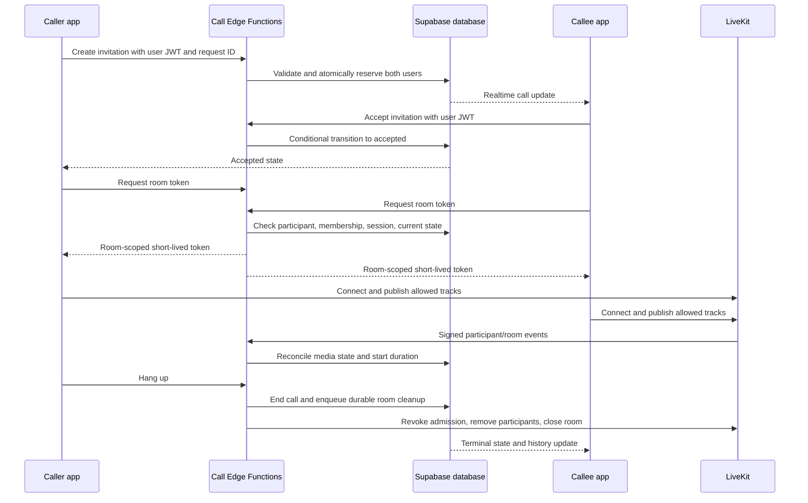

# DoloGram Voice and Video Calling Implementation Plan

Prepared: 2026-11-11 (Asia/Manila). Status: proposed implementation plan; no calling functionality is implemented by this document.

## 1. Goal and scope

Implement one-to-one internet voice and video calls inside DoloGram using:

- **LiveKit Cloud:** transport microphone and camera streams.
- **Supabase Postgres and Realtime:** persist invitations, authoritative call state, participants, and history; notify signed-in clients about changes.
- **Supabase Edge Functions:** authenticate callers, enforce membership and call permissions, issue short-lived LiveKit tokens, process signed LiveKit events, and clean up abandoned sessions.
- **Expo/React Native screens:** outgoing call, incoming call, connecting, active call, reconnecting, and ended states, with answer, decline, hang up, mute, audio routing, camera toggle, and camera switch controls.

Delivery target: the existing Android app first. Keep shared contracts and the media abstraction suitable for iOS and a future web client, but do not claim support for those clients before their own builds and verification.

The first usable milestone supports calls while both apps are in the foreground. A subsequent milestone adds notification invitations. Reliable lock-screen calling and continued calls in the background require a separate native integration milestone described in Section 10.

Initial exclusions: group calls, telephone numbers/PSTN, recording, transcription, screen sharing, picture-in-picture, call transfer, and voice-to-video upgrades during an existing voice call. A voice call publishes microphone audio only; a video call permits microphone and camera tracks, with explicit camera controls. Transport encryption is used, but application-managed end-to-end encryption is a separate future design and must not be advertised as implemented.

## 2. Repository findings and integration constraints

| Existing location | Reuse or planned change |
| --- | --- |
| `apps/mobile/package.json` | Expo `~57.0.32`, React Native `0.86.3`, existing `expo-dev-client`, `expo-audio`, `expo-video`, and `expo-notifications`. Verify LiveKit native compatibility before committing to SDK versions. |
| `apps/mobile/app/_layout.tsx` | Mount an authenticated, account-scoped call provider and global incoming-call presentation. Extend the existing notification response router. |
| `apps/mobile/app/chat/[chatId]/index.tsx` | Add voice and video buttons to the chat header for eligible direct chats. Retain the existing info action. |
| `apps/mobile/src/chat/realtime.ts` | Existing per-chat Broadcast is used for typing/read hints and is mounted with a chat. Incoming calls need an app-wide subscription, not just this chat channel. |
| `apps/mobile/src/sync/source.ts` | Existing Postgres Changes delivery and payload validation offer patterns to reuse. Calls get a separate delivery lifecycle rather than being forced into message synchronization. |
| `apps/mobile/src/notifications/pushNotifications.ts` | Reuse registration and response subscriptions; distinguish call invitations from message notifications. |
| `apps/mobile/src/auth/accountSession.ts`, `apps/mobile/src/storage/localData.ts` | End/leave calls, cancel asynchronous work, clear account-scoped state, and remove subscriptions when accounts change or sign out. |
| `apps/mobile/src/components/VoiceRecordButton.tsx`, `VoiceNotePlayer.tsx`, `VideoPlayback.tsx` | Coordinate audio ownership so voice recording/playback and calling do not capture or configure the microphone simultaneously. |
| `apps/mobile/app.json`, `app.config.js`, `eas.json` | Add native configuration through Expo config plugins and produce a new EAS development build, followed by a preview build. |
| `packages/shared/src/db/database.types.ts`, `strings/index.ts`, `theme/icons.ts` | Regenerate database types and add common call contracts, copy, and icons. Keep the native LiveKit dependency outside the shared package. |
| `supabase/migrations/016_align_messenger_schema.sql` | Use the current `chats.chat_id`, `chats.type`, and `chat_members.user_id` contract, not the original pre-alignment schema. |
| `supabase/functions/send-push-notifications/` | Reuse delivery patterns and active-user checks; retain separate call payloads, expiry rules, preferences, and deduplication. |

Repository migration issue: both `025_add_group_chat_avatars.sql` and `025_shared_chat_nicknames.sql` currently exist. Before allocating call migrations, inspect the target project's migration history and reconcile the duplicate version against deployed state. Preserve already applied versions, as required by `supabase/AGENTS.md`. The proposed migration names below deliberately use `<next>` rather than reserving a number now.

Use the actual `apps/mobile/app/` routes. The mobile AGENTS file's generic `src/app/` guidance does not match the existing layout; do not move existing routes for this feature.

Follow existing EAS cloud-build conventions. Do not create or edit generated Android/iOS projects manually. Install native dependencies with `npx expo install`, pin the versions validated with SDK 57, and record them in `docs/versions.md`. LiveKit needs a development build and cannot run in Expo Go. [LiveKit Expo guide](https://docs.livekit.io/transport/sdk-platforms/expo/), [Expo SDK 57](https://docs.expo.dev/versions/v57.0.0/)

## 3. Product behavior and initial defaults

These are implementation defaults, adjustable through server configuration after observing usage:

| Decision | Initial behavior |
| --- | --- |
| Eligible conversation | A direct chat with exactly two distinct current members. Reject groups, Saved Messages, and incomplete one-member direct chats. |
| Concurrent calls | One ringing, accepted, or active call per user across devices and chats. The database enforces this. |
| Ring window | 30 seconds from server creation time. Network delivery does not extend the deadline. |
| Connection window | 30 seconds after acceptance to establish both participants, otherwise fail and release reservations. |
| Disconnect grace | 20 seconds for a connected participant to recover; reconciling server state determines the final result. |
| Token TTL | 5 minutes for initial admission. Check exact SDK refresh and revocation behavior in the compatibility milestone. |
| Pilot maximum duration | 30 minutes, enforced by the server, with a visible warning near the limit. This is a configurable budget control, not a LiveKit free-plan limit. |
| Camera privacy | No remote camera/microphone publishing before acceptance. Camera preview is local and optional. Support answering a video invitation with camera initially off. |
| Speaker default | Voice: earpiece when available. Video: speaker when no headset is connected. Prefer the connected wired/Bluetooth route and reflect the actual route in the UI. |
| Background, first milestone | Foreground-only. Leaving the foreground stops publishing and ends the call on a best-effort basis; server cleanup covers process termination. Do not promise background audio until the native milestone ships. |
| Navigation within app | Back minimizes an active call into a persistent return-to-call banner; only hang up ends it. Maintain one media session above individual screens. |
| History | Per-chat Calls screen with incoming/outgoing, voice/video, outcome, timestamp, duration, and call-again actions. No new main tab or message schema change is required. |
| Notifications | Respect account notification settings and chat mute preferences for audible alerts. A persisted invitation/history record remains even when alerts are silenced. |

If a user is offline, never add a call action to the existing message queue. Show an immediate connectivity error. Reconnection may reconcile an existing call; it must not replay an expired invitation.

## 4. Architecture and end-to-end flow



Supabase is authoritative for permission, invitation status, and history. LiveKit is authoritative for media connectivity. Client events improve responsiveness but cannot establish another user's acceptance, rewrite history, or certify that a peer actually joined.

Create no room connections and issue no media tokens during ringing. This limits accidental publishing and avoids spending participant minutes on unanswered invitations. A unique opaque room name is generated per call and never reused.

## 5. Database and authoritative state

### 5.1 Proposed tables

| Table | Core fields and responsibility |
| --- | --- |
| `calls` | `call_id`, `chat_id`, `caller_id`, `callee_id`, `media_type` (`voice`/`video`), `status`, `created_at`, `ring_expires_at`, `accepted_at`, `connect_expires_at`, `connected_at`, `ended_at`, `ended_by`, `end_reason`, monotonic `revision`, caller-scoped `request_id`. One row per attempt, including a busy outcome. |
| `call_participants` | Composite key `(call_id, user_id)`, role, selected client-session ID, opaque LiveKit participant identity, join/leave observations, current connection generation, last media observation, and reconnect deadline. Exactly the two intended users. |
| `call_user_reservations` | `user_id` primary key, `call_id`, lease deadline. Atomically reserve both users during ringing and retain through accepted/active states. No client writes. |
| `private.call_rooms` | Internal mapping from call to room name, room SID/generation, room readiness, termination/revocation cutoff, and cleanup state. Not published through Realtime or readable by normal users. |
| `private.call_jobs` | Durable outbox for room cleanup and, later, invitation push dispatch. Include unique deduplication key, attempt count, next attempt, and completion/error state. |
| `private.call_webhook_events` | Provider event ID primary key, processing status, event timestamp, and minimal required metadata. Deduplicate replayed events; avoid persisting tokens or unnecessary raw payloads. |

Use foreign keys to the current chat/user keys, status and media-type checks, caller-not-equal-to-callee checks, and consistency constraints on terminal timestamps. Index participant history by `(user_id, created_at)` through the chosen history query design, calls by `(chat_id, created_at desc, call_id)`, and pending deadlines/jobs. Make `(caller_id, request_id)` unique to handle create retries without duplicate calls or notifications.

Keep operational tables in a private schema. Return only safe call fields through authenticated endpoints/RLS. Tokens are never database history fields, URLs, push payloads, analytics attributes, or SQLite values.

### 5.2 State transitions

| From | To | Authorized trigger |
| --- | --- | --- |
| none | `ringing` | Caller creates a valid invitation and both reservations succeed. |
| none | `failed` (`busy`) | Valid attempt finds either participant reserved; return busy and persist a single history outcome without disturbing the existing call. |
| `ringing` | `accepted` | Callee accepts before the server deadline; bind the winning callee client session. |
| `ringing` | `declined` | Callee declines. |
| `ringing` | `cancelled` | Caller cancels. |
| `ringing` | `missed` | Server ring deadline passes without an earlier transition. |
| `accepted` | `in_progress` | Server verifies both expected participants are connected to the current LiveKit room. |
| `accepted` | `ended` | Either participant hangs up before connection completes. Duration is zero. |
| `accepted` | `failed` | Connection deadline passes or unrecoverable permission/provider setup fails. |
| `in_progress` | `ended` | Either participant hangs up, maximum duration is reached, or a server policy terminates the call. |
| `in_progress` | `failed` | Media does not recover within the disconnect grace period, or a provider failure is confirmed. |

`declined`, `cancelled`, `missed`, `ended`, and `failed` are terminal. Never reopen a terminal call. `connecting` and `reconnecting` are UI/participant states, not alternate invitation statuses.

Every transition runs in a transaction with row locking, deadline checks, and a conditional current-state/revision check. Reserve users in a stable user-ID order to avoid deadlocks. A unique reservation row enforces the rule even when different chats call the same user at the same moment. Simultaneous A-to-B and B-to-A calls produce one ringing call and a busy response for the losing attempt; its client can discover the existing incoming call.

Repeated accept/decline/hang-up requests return the resulting authoritative state. If accept races cancel or timeout, the first valid database transition wins. Only one device can win acceptance; the remaining devices dismiss their ringing UI. A reconnect by that selected session is allowed; another device cannot silently take over.

Release reservations in the same transaction as terminal state and durable cleanup enqueueing. Expired rows are not deleted blindly: the worker first reconciles and terminalizes the owning call. Client clocks and missing heartbeats alone are not evidence that an otherwise healthy media call ended.

Duration is server-defined elapsed time from the first verified simultaneous connection to terminal time, including short reconnect gaps. Store timestamps and derive duration, rather than trusting the client timer. If only one side joined, duration remains zero. For failures detected later, use the last confirmed media/disconnect time where available; mark uncertain measurements internally rather than inventing precision.

### 5.3 RLS and database functions

- Permit history/state reads only to the recorded caller or callee while they still have access to that chat. Membership alone must not reveal a previous pair's call to a newly added member.
- Deny direct authenticated inserts/updates/deletes to call state, participant bindings, reservations, and operational tables.
- Expose narrow transaction functions for create, accept, decline, cancel, end, participant-session binding, and server reconciliation. Derive the actor from the verified JWT, not a request-body user ID.
- If any function uses `SECURITY DEFINER`, pin `search_path`, fully qualify references, revoke default/public execution, grant only its intended role, and explicitly check actor and membership. Private worker-only functions accept verified server authority only.
- Call lifecycle functions must validate active-account restrictions already used by notification delivery, including bans and mandatory password changes. Apply these checks again when issuing tokens.
- Membership revocation/account deactivation must schedule termination and room removal for an existing call, not merely prevent the next token request.
- Add only the safe call/participant tables to `supabase_realtime`; do not publish secrets, webhook payloads, or the operational tables.

## 6. Edge Function contracts and security

### 6.1 Endpoints

| Endpoint | Request | Result and checks |
| --- | --- | --- |
| `call-action` | `{ action: 'create', chatId, mediaType, requestId, clientSessionId }` | Validate JWT, active users, exactly two eligible members, rate limit, feature flag, and reservations. Derive callee and actor server-side. Return safe call state. |
| `call-action` | `{ action: 'accept' | 'decline' | 'cancel' | 'end', callId, requestId, clientSessionId }` | Check actor role, membership, selected-session policy, status, and deadlines; invoke the corresponding atomic transition. |
| `call-token` | `{ callId, clientSessionId }` | Admit only the caller or selected accepting callee to an accepted/in-progress call. Bind the caller's winning session atomically. Return `{ serverUrl, participantToken, expiresAt, callId, revision }`. |
| `livekit-webhook` | Provider-signed raw body | Verify LiveKit signature/body integrity, persist/deduplicate event, map room and identity to the intended call, reconcile, and enqueue cleanup where required. |
| `reconcile-calls` | Server scheduler credential | Expire ringing/connecting calls, confirm media recovery or failure, process retry jobs, enforce duration limits, and repair missed provider events. Not callable by ordinary users. |
| `send-call-notifications` | Internal outbox job, later milestone | Resolve current eligible tokens/preferences and send short-lived, deduplicated invitation notifications. No user-supplied recipient list. |

Use `supabase.functions.invoke` with the active user's JWT for user endpoints, verify authentication server-side, and retain platform JWT verification where supported. Existing webhook functions with `verify_jwt = false` are not templates for unauthenticated user endpoints. Provider webhooks need `verify_jwt = false` because LiveKit does not supply a Supabase JWT; signature verification is mandatory inside the handler. [Supabase function authentication](https://supabase.com/docs/guides/functions/auth)

Use a stable error envelope such as `{ code, message, retryable }`. Cover `CALL_BUSY`, `CALL_EXPIRED`, `CALL_ALREADY_HANDLED`, `CALL_NOT_ALLOWED`, `CALL_PERMISSION_REQUIRED`, `CALL_PROVIDER_UNAVAILABLE`, `CALL_FEATURE_DISABLED`, and `CALL_RATE_LIMITED`; map them to shared user-facing strings. Return 401 for invalid authentication, 404 for inaccessible calls to avoid disclosing existence, 409 for conflicting state, and 429 with retry guidance for limits. Recover a lost response by reading the authoritative state, not by creating a new attempt ID.

### 6.2 Token policy

- Store `LIVEKIT_URL`, `LIVEKIT_API_KEY`, and `LIVEKIT_API_SECRET` only in Edge Function secrets. Keep privileged Supabase credentials server-side. No `EXPO_PUBLIC_` LiveKit secret or client-side token minting.
- Use a server-generated opaque identity per call participant and a unique opaque room name. Do not put names, usernames, emails, or telephone numbers in these identifiers.
- Allow joining exactly the call's room, subscribing, and publishing only the required sources. Voice permits microphone; video permits microphone and camera. Deny room administration, recording, room listing, screen sharing, and unrelated data publishing.
- Set explicit five-minute initial TTL. Keep returned tokens in memory only and discard them on call end or account change.
- Check current state, participant/session binding, membership, and server feature flags on every issuance. A caller may never supply an arbitrary room or participant identity.
- TTL does not end an already connected call. Ending a call requires server removal/revocation and room cleanup, plus the database terminal state. LiveKit refreshes connected participants' credentials; validate removal against refreshed tokens too. [LiveKit token lifecycle and grants](https://docs.livekit.io/frontends/reference/tokens-grants/)

### 6.3 Cross-service failure handling

Database transactions and LiveKit API requests cannot be one atomic transaction. Use durable jobs, bounded retries, and idempotent provider operations rather than assuming both succeed together.

Serialize token issuance and termination for each call through a backend-controlled lease/fencing design. Termination first prevents new issuance, waits for or fences any in-flight issuance, records a revocation cutoff that covers those tokens, removes both participant identities with the supported explicit cutoff, and closes the room. Repeat cleanup until confirmed. Do not assume deleting a room alone makes an already issued join token unusable or that the default revocation clock buffer is sufficient. Phase C0 must prove that an old or refreshed token cannot recreate/rejoin an ended call on the selected LiveKit Cloud SDK/API version.

On create/accept provider failure, retain recoverable database state only within its connection deadline. On a lost token response, a safe retry is allowed for the same bound session while the call is live. On an end failure, both clients stop local media immediately, the database remains terminal, and the cleanup job retries until provider termination is confirmed. Unconfirmed cleanup is an operational alert, not a successful server cleanup result.

Verify webhook signatures against the unmodified request body with the pinned server SDK; do not parse and reserialize first. Use event IDs for idempotency, room SID and participant connection generation to reject stale leave events, and current LiveKit state when event ordering is ambiguous. Never revive a terminal call after a late join event; remove the participant instead. LiveKit webhook delivery is not guaranteed, so a scheduled worker must reconcile with the Room Service API. [LiveKit webhook delivery](https://docs.livekit.io/intro/basics/rooms-participants-tracks/webhooks-events/), [Room Service API](https://docs.livekit.io/reference/server-sdk-js/classes/RoomServiceClient.html)

Run deadline/job processing on a supported server schedule, initially every 10 seconds if available on the target project. Record the actual schedule and resulting timeout tolerance in C1; do not promise second-accurate expiry from a minute-based schedule. UI timers dismiss stale ringing at the server deadline, but the worker makes the durable transition. Bound provider calls and retry backoff to avoid exhausting function quotas.

## 7. Mobile call lifecycle and screens

### 7.1 Modules

Create `apps/mobile/src/calls/` containing:

- `CallProvider.tsx` and `useCall.ts`: one active session, account-scoped orchestration, incoming invitations, navigation banner, and cleanup.
- `api.ts`: typed Edge Function requests and RLS-backed state/history reads.
- `realtime.ts`: app-wide subscriptions and resubscription/refetch logic.
- `media.ts`: a narrow LiveKit adapter for connect/disconnect, tracks, device permissions, audio routing, and SDK connection events.
- `state.ts`: presentation-state reducer, separate from server transition authority.
- `permissions.ts`: microphone/camera request flow and denied/revoked permission behavior using the validated native integration.
- `history.ts` and `components/`: paginated history, controls, participant view, incoming/outgoing presentation, and return-to-call banner.

Shared code belongs in `packages/shared/src/calls/` for status/media types, validation, error codes, and repository helpers, plus the existing strings/icons locations. Do not import native media code there.

### 7.2 Realtime delivery and recovery

Maintain filtered Postgres Changes subscriptions for calls where the current user is caller and where they are callee, with RLS as the security boundary. Observe the active call's participant rows as needed. This works even when a different chat is open. Reuse an existing application-wide channel only if its lifecycle and filters fit; do not duplicate subscriptions per screen.

Subscribe and wait for subscription readiness, then fetch pending/live invitations. Merge events and fetch results by `call_id` and `revision`; discard older revisions. Repeat reconciliation on reconnect, app foreground, auth refresh, and notification taps. Deduplicate invitations and stop ringtone on every accepted/terminal state, deadline, sign-out, or account switch. Realtime is a prompt to reconcile, never a guarantee of delivery.

Use a bounded polling fallback while a live call has a signaling outage, and refetch server state before reconnecting media. Stop polling at terminal state. A LiveKit reconnection does not authorize joining a terminal call.

### 7.3 Screens and controls

Proposed routes, outside the main tab navigator:

- `apps/mobile/app/call/[callId].tsx`: outgoing, incoming, connecting, active, reconnecting, and ended presentation driven by one provider.
- `apps/mobile/app/chat/[chatId]/calls.tsx`: paginated call history with eligibility-aware call-again actions.

Requirements:

- Add voice/video launch buttons only for eligible chats; disable during creation or an existing reservation and explain disabled/offline states.
- Incoming screen shows caller, voice/video label, answer and decline. Video preview never publishes before acceptance. A stale deep link resolves to ended/missed history, never a new call.
- Outgoing screen offers cancel; accepted state says connecting until media is verified. Active duration starts at server `connected_at`, with a monotonic local display corrected after refetch.
- Mute disables microphone publishing and shows its real state. Camera off stops camera publication; camera switch is enabled only when available. A voice call cannot turn on video through its UI or token grants.
- Speaker/audio-route control uses supported LiveKit native APIs selected in C0, handles unavailable routes, headset changes, Bluetooth permissions, and route failures. Test actual sound output, not only the icon.
- Stop/pause voice recording, voice-note playback, and video playback before taking call audio ownership; prevent a recorder from starting during a call. Restore normal audio mode after every exit path.
- Permission denial produces clear retry/settings actions. Denying microphone prevents create/accept; camera denial allows audio-only participation in a video room with explicit UI feedback. Never repeatedly prompt without user action.
- Prevent duplicate taps, display connection/reconnection feedback, support large text, themed contrast, accessible control names/states, and reasonable touch targets.
- Signing out or changing account invalidates all pending call work with an account/session generation guard. Disconnect local media immediately, request server end where possible, and never apply the old account's delayed token or event to the new account.

## 8. Call history and local data

Start with a dedicated per-chat history query keyed by `(created_at, call_id)` with a fixed page size, rather than altering message content to impersonate a call record. Use shared outcome formatting: missed incoming call, unanswered outgoing call, declined, cancelled, busy, connected, or failed. Call again creates a new request/call after rechecking eligibility.

MVP history is server-backed with an in-memory account-scoped cache and a clear offline state. If persistent offline history is added later, extend the existing SQLite schema/cache deletion lifecycle and account boundaries explicitly; never silently store admission tokens. Clear current in-memory history on sign-out, account change, or loss of chat access. Define any long-term server retention/deletion policy alongside the existing account/chat deletion behavior before broad release; do not introduce arbitrary automatic history deletion in the initial migration.

## 9. Implementation phases and exit criteria

All checkboxes start pending. Each phase records work, checks, configuration dependencies, and any remaining manual steps in `docs/test-results/calling/phase-CN.md`. Existing Android-plan convention permits unavailable device/accounts/configuration checks to be recorded as optional pending manual verification for development-phase completion. Such a record is not evidence that untested media or platform behavior works; release notes must state the actual verified support.

| Phase | Work | Depends on | Exit criteria |
| --- | --- | --- | --- |
| **C0: Compatibility and contracts** | Validate Expo 57/RN 0.86 with current LiveKit packages and Deno server SDK. Prove native build, mic/camera, audio routing, token refresh/revocation, and room cleanup. Finalize schema/API contracts, flags, defaults, and migration reconciliation strategy. | Existing app baseline | Versions and API choices recorded; native build and integration feasibility demonstrated or exact external verification pending documented; no known compatibility defect left unresolved. |
| **C1: Database and authorization** | Add sequential migrations, tables, constraints, RLS, transaction functions, rate limits, reservation locking, outbox, deadline worker scheduling, and generated types. | C0 | Unauthorized users cannot read/mutate calls; concurrent calls and terminal races produce one valid result; reservations and deadlines recover after worker restarts. |
| **C2: LiveKit backend** | Implement call-action/token endpoints, signed webhook handler, room management, retry/reconciliation worker, server flags, and secret setup documentation. | C1 | Membership/session checks and least-privilege tokens pass; provider failures recover; stale tokens/events cannot revive ended calls; no leaked secrets. |
| **C3: Foreground voice** | Add global call provider, realtime recovery, chat launch controls, incoming/outgoing route, answer/decline/cancel/end, microphone mute, audio routing, audio ownership, and account cleanup. | C2 | Two foreground clients complete voice calls; busy/missed/declined/cancelled/error outcomes work; navigation does not duplicate media sessions; ending releases microphone and reservations. |
| **C4: Foreground video** | Add remote/local video, camera permissions, camera toggle/switch, answer-with-camera-off, adaptive media settings, and poor-network feedback. | C3 | Video connects, audio remains usable with camera off, voice cannot publish camera, and teardown releases all media. |
| **C5: History and resilience** | Add history route, pagination, outcome/duration formatting, missed-event recovery, app lifecycle handling, quota failures, abuse controls, and operational metrics. | C4 | Crash/offline/reconnect/account-switch races recover coherently; history contains one attempt per request; current phase's regression checks pass. Foreground pilot is reviewable. |
| **C6: Invitation notifications** | Add call-specific push dispatch, expiry/deduplication, mute preferences, notification routing, cancellation handling, and notification-tap revalidation. | C5 | Notification opens only a still-valid invitation for the correct active account; stale/cancelled pushes do not ring or join; message notifications retain current behavior. |
| **C7: Native background calling** | Add Android calling integration/foreground service and native incoming-call presentation; separately validate iOS PushKit/CallKit and audio session behavior if iOS is selected for delivery. | C6 | Supported background/lock-screen scenarios are verified and documented for each delivered platform; fresh native builds exist. |
| **C8: Release and operations** | Produce preview build, run release checks, write configuration/troubleshooting/rollback guide, enable a small pilot, review metrics and quotas. | C5 for foreground pilot; C6/C7 for expanded claims | Deliver only the modes actually implemented and verified; feature flags and cleanup work during rollback; release notes name unsupported modes. |

Suggested migration groups: `<next>_create_calling_schema.sql`, `<next>_secure_call_lifecycle.sql`, `<next>_enable_call_realtime_and_jobs.sql`, and, in C6, `<next>_add_call_notification_preferences.sql`. Allocate actual sequential versions after resolving deployed history; do not rename applied files to fit these examples.

## 10. Notification and native background milestones

C6 uses the existing push registration infrastructure for an ordinary expiring invitation. Payload contains a type discriminator, call ID, recipient account ID, and server deadline; omit room credentials and private previews unless explicitly allowed. Deduplicate on call/device/event and recheck state immediately before dispatch. A notification tap verifies current account, membership, status, and deadline through the server before rendering answer controls. A push is never acceptance or authorization to connect.

Do not automatically switch to a saved account or display another account's caller details from a notification. If needed, route to an account-choice/sign-in flow, then revalidate the invitation. Dismiss local ringing on accepted/terminal changes across devices; cancellation notifications are best effort and the embedded deadline remains the fallback.

C7 is separately scoped because ordinary push delivery and JavaScript execution do not guarantee wake-up, ringing, or continued media under every OS state. Validate the currently supported Android Telecom/ConnectionService or Core-Telecom approach, call-style notification behavior, microphone/camera foreground-service requirements, notification/full-screen permissions, and store policy eligibility against official platform documentation at implementation time. Evaluate a maintained Expo-compatible native bridge in C0/C7 before choosing a library. iOS requires its own CallKit/PushKit design and APNs credentials if delivered. Follow Expo's current notification behavior documentation rather than assuming background execution. [Expo notification behavior](https://docs.expo.dev/push-notifications/what-you-need-to-know/)

Document separately: foreground, app backgrounded, screen locked, process removed by OS, and user force-stopped. A force-stopped app must not be promised reliable incoming calls. Request native permissions in context and preserve user mute preferences. Background video, where unsupported, stops camera publication while an explicitly supported audio session continues.

## 11. Verification matrix

| Area | Required meaningful cases |
| --- | --- |
| SQL/security | Anonymous/nonmember access; participant vs unrelated member; forged actor/room/media/session; banned/restricted accounts; direct/group/self/incomplete chats; direct writes blocked; membership revoked during call. |
| Concurrency | Simultaneous opposite-direction calls; two callers to one callee; two devices accepting; duplicate create; accept vs timeout/cancel/decline; simultaneous hang-up; worker retries after restart. |
| Tokens/provider | Room/source grants; explicit TTL; expired initial admission; refreshed-token reconnect; strict removal cutoff; issuance vs termination; ended-room recreation; quota denial; slow/missing provider responses. |
| Webhooks/jobs | Invalid signature; body tampering; duplicates; out-of-order/stale room or participant events; lost join/leave/finish; delayed webhook after terminal state; cleanup retry; worker lag. |
| Voice/video | Two-way voice/video; mute; real earpiece/speaker/headset output; camera toggle/switch; camera-off answer; permission denial/revocation; no tracks before acceptance; media released after every exit. |
| Lifecycle/network | Back/minimize/return; app foreground/background policy; reload/crash; Wi-Fi/mobile handover; signaling-only outage; media-only outage; reconnect expiry; slow network; sign-out/account switch during token request. |
| History/push | Correct direction/outcome/duration; page boundaries/no duplicates; offline history state; muted chats; expired push; duplicate push; wrong-account push; cancelled-before-delivery; existing message notification routing. |
| Regression | Messaging, attachment playback, voice notes, account switching, normal notifications, shared package imports, and app startup with calling disabled. |

Use SQL integration tests under `supabase/tests/`, Deno tests next to Edge Functions, shared Vitest tests, and React Native Jest tests for the call reducer/provider and controls. Mock external provider faults for automation, but do not treat mocked audio/video as proof of working media.

Run the checks appropriate to the implemented phase:

```powershell
npm run typecheck
npm run lint --workspace @dologram/mobile
npm run test --workspace @dologram/shared
npm run test --workspace @dologram/mobile -- --runInBand
npm run scan:mobile-bundle
```

Add documented Deno and SQL test commands when their fixtures/functions exist. The root `gen:types` script currently contains placeholder project parameters; use the verified target project reference to regenerate types rather than running it blindly.

Media QA needs two independently authenticated clients and ideally real devices on different networks. Respect existing workspace/device restrictions; do not open unrelated emulators/apps or assume a second device is authorized. Record unavailable external verification with exact follow-up steps. Use the existing EAS development/preview profiles for native builds and capture package versions, build identifiers, configuration state, and results in phase reports.

## 12. Rollout, usage budget, and rollback

- Add server-controlled `calling_enabled`, pilot-user allowlist, and separate `call_push_enabled` / native-background capability flags. Client visibility is not enforcement. Disabled calling must not initialize native media or break ordinary messaging.
- Configure secrets in Supabase, provider webhook URL/signing key, scheduler credentials, function auth settings, call notification preferences, and the selected LiveKit project. Maintain a sample configuration containing names only, with no real credentials.
- Monitor invitation-to-accept/connect time, completed and failed calls, classified failure reason, missed/declined/busy rates, reconnects, worker delay, cleanup failures, participant minutes, and data transfer. Log opaque call IDs rather than tokens or personal media contents. Scrub SDK/error objects before logging.
- Initial abuse limits: at most five create attempts per user per minute and a cooldown after repeated unanswered calls to the same peer. Enforce on the server across devices, count unsuccessful attempts, and make thresholds configurable. Token issuance also needs bounded retry/rate limits that permit legitimate reconnects.
- LiveKit currently lists 5,000 monthly WebRTC participant minutes, 50 GB downstream transfer, and 100 concurrent connections on Build. Both time and data limits matter; a ten-minute two-person call consumes about twenty participant minutes. These are provider allowances, not guaranteed production capacity. Recheck them before rollout. [LiveKit pricing](https://livekit.com/pricing), [Quotas and limits](https://docs.livekit.io/deploy/admin/quotas-and-limits/)
- Start video with a conservative validated resolution/bitrate, adaptive subscription behavior, and lower quality on weak links. Preserve voice where possible; show failures when provider quotas prevent a new connection. Review Supabase function, database, Realtime, and scheduler allowances too; a free media tier does not imply unlimited free infrastructure.
- Warn on usage thresholds, enforce the pilot call-duration limit, and handle quota rejection cleanly. Do not automatically upgrade or enable paid plans as part of implementation.
- Roll back by disabling new create/accept/token issuance through the server flag, explicitly draining/ending existing calls according to the incident policy, and keeping reconciliation, webhook handling, cleanup jobs, and history reads running. An already shipped client must receive a normal disabled/error response. Avoid destructive schema rollback; retain call records and deploy a compatible client fix.

## 13. Definition of done

The foreground release is implemented when C0-C5 and its C8 release work are complete: eligible users can initiate, answer, decline, cancel, and end voice/video calls; controls operate on actual media; state/history and multi-device races are consistent; credentials stay server-side; stale calls and media are cleaned up; and messaging/account workflows retain their behavior.

Notification invitations and native background calling are tracked as C6 and C7, with separate verified support claims. Any pending manual/device/provider checks are named explicitly in the handoff rather than counted as passed. Implementation begins with C0, followed by the dependency order above.
